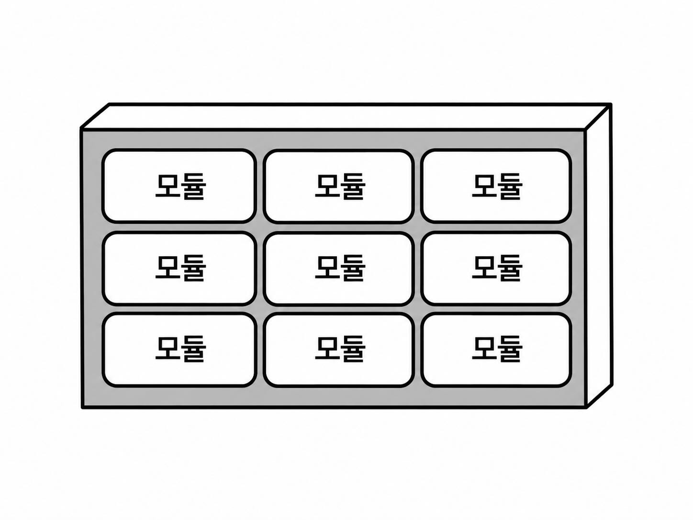
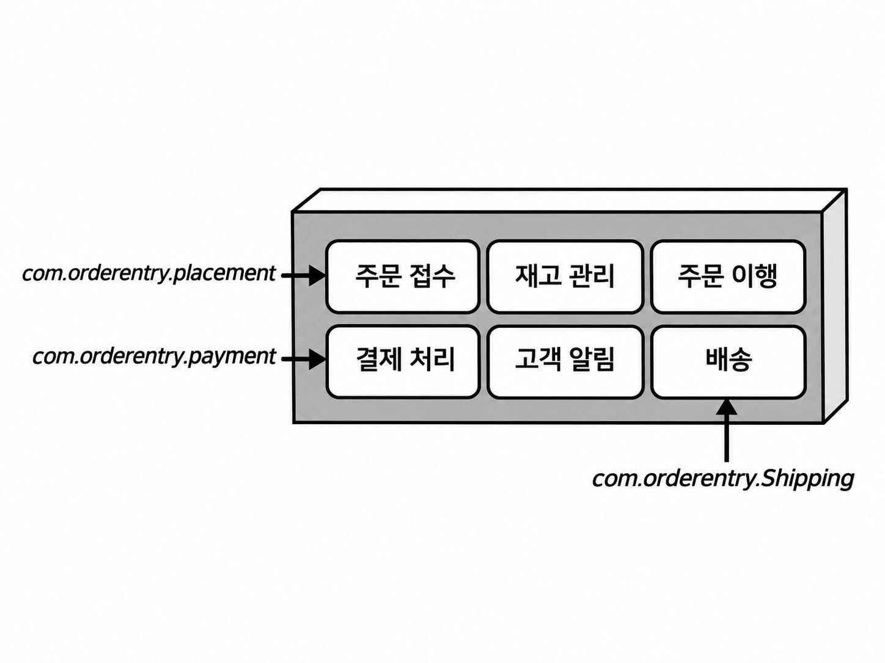
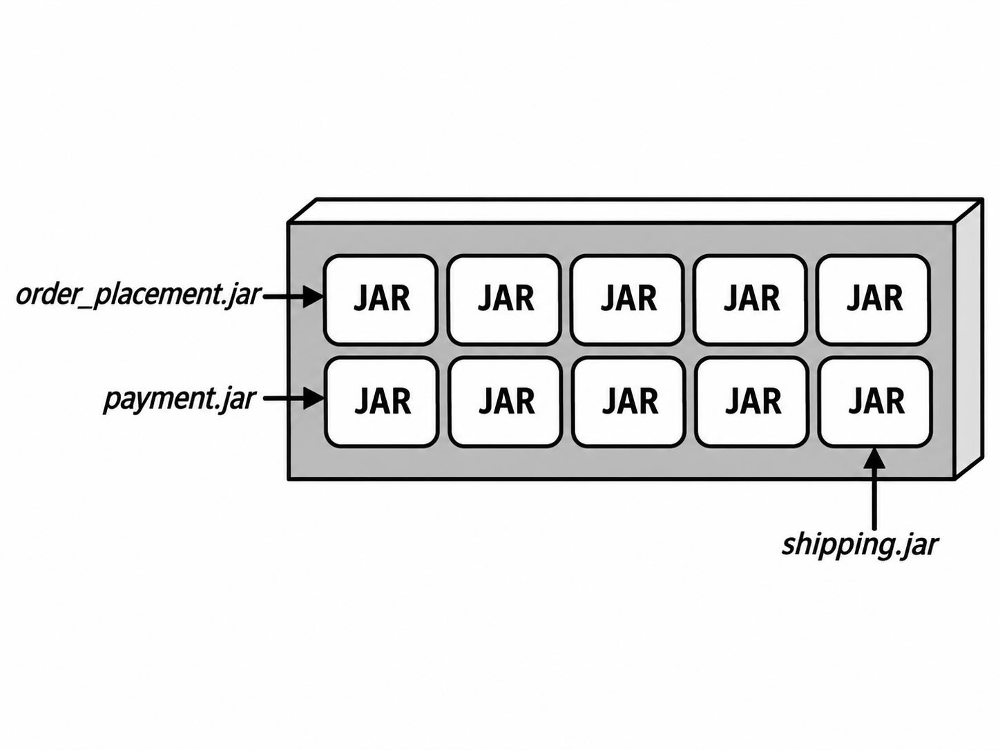
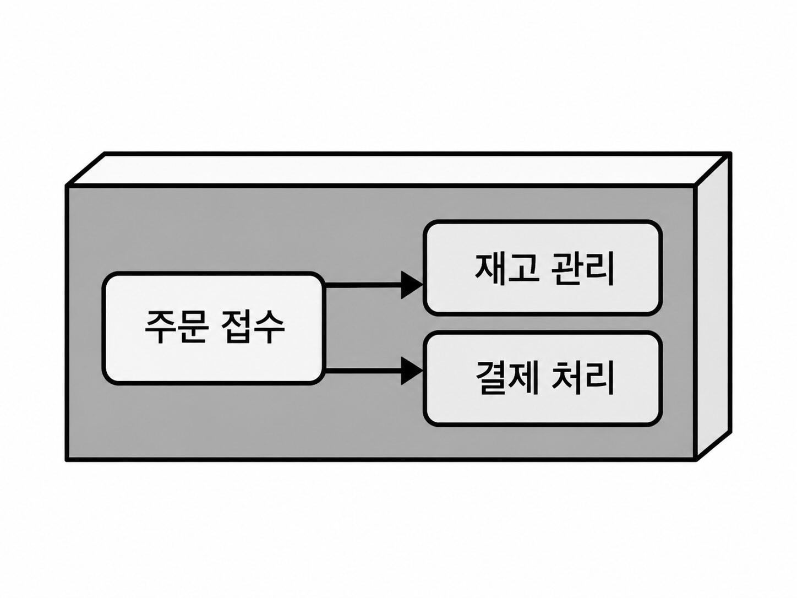
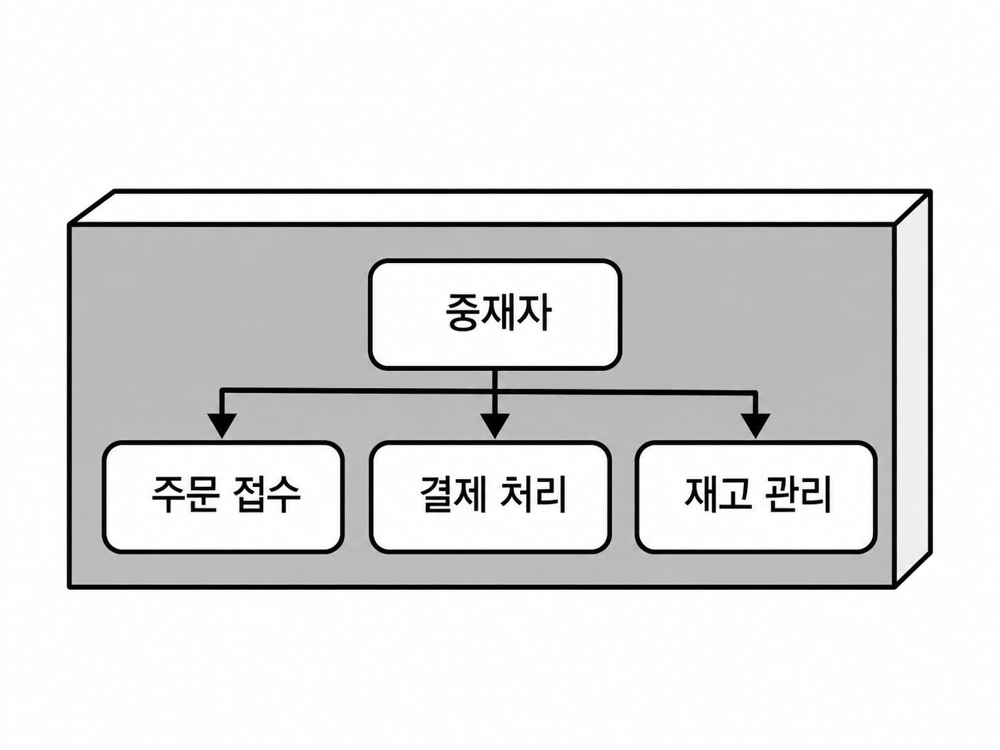

## 모듈형 모놀리스 아키텍처 스타일

### 11.1 토폴로지

- 모듈형 모놀리스는 이름 그대로 모놀리스 아키텍처이다.
    - 전체 시스템은 하나의 배포 단위로 배포된다.
- 계층형 아키텍처도 모놀리스지만, 분할 기준이 다르다.
    - 계층형 아키텍처: 표현, 비즈니스, 영속성 등 기술적 관심사를 중심으로 분리
    - 모듈형 모놀리스: 주문, 결제, 재고, 배송 등 도메인 관심사를 중심으로 분리
- 하나의 도메인 모듈 내부에서 필요하면 다시 표현, 비즈니스 등의 기술적 관심사로 세분화할 수 있다.

### 11.2 스타일 세부 사항

모듈을 구성하는 방식은 크게 두 가지가 있다.

#### 11.2.1 모놀리스 구조

- 모든 모듈과 논리적 컴포넌트가 하나의 코드베이스에 존재한다.
- 디렉터리나 이름공간(namespace) 등을 이용해 모듈을 구분한다.
- 배포할 때 모든 모듈의 코드를 하나의 단위로 묶어 배포한다.

장점
- 모든 코드가 한곳에 있어 유지보수, 테스트, 배포 구조가 단순하다.

주의점
- 같은 코드베이스 안에 있으므로 다른 모듈의 코드에 접근하기 쉽다.
- 모듈 경계를 유지하려면 엄격한 거버넌스가 필요하다.
- 무분별한 코드 재사용이나 모듈 간 통신을 허용하면 모듈 경계가 무너져 진흙잡탕 구조로 변할 수 있다.

#### 11.2.2 모듈형 구조

- 각 모듈을 JAR, DLL 같은 독립적이고 자기 완결적인 요소로 구성한다.
- 각 모듈은 별도로 개발하고 컴파일할 수 있다.
- 다만 최종적으로는 모든 모듈을 하나의 배포 단위로 결합하여 배포한다.

장점
- 팀마다 개별 모듈을 맡아 개발하기 쉽다.
- 모듈 간 경계가 더 명확하다.
- 서로 다른 전문 지식이나 비즈니스 지식이 필요한 복잡한 시스템에 적합하다.
- 다른 모듈의 코드를 무분별하게 재사용하거나 과도하게 통신하는 경향을 줄일 수 있다.
- 관심사를 더 명확하게 분리할 수 있다.

단점
- 모듈끼리 강하게 의존하고 자주 통신해야 한다면 오히려 모놀리스 구조가 더 단순할 수 있다.

### 11.2.3 모듈 간 통신

모듈은 독립적으로 구성하는 것이 좋지만 실제 업무에서는 다른 모듈의 기능이 필요한 경우가 많다.

예시)
- 주문 접수 -> 재고 관리
- 주문 접수 -> 결제 처리

모듈 간 통신 방식은 크게 두 가지로 나눌 수 있다.

#### 동급 간 접근법

- 모듈들이 서로 직접 통신하는 방식이다.
- 가장 단순한 형태는 한 모듈의 클래스가 다른 모듈의 클래스를 직접 생성하거나 메서드를 호출하는 것이다.

모놀리스 구조
- 같은 코드베이스에 있으므로 다른 모듈의 클래스를 직접 참조하기 쉽다.
- 편리하지만 의존성이 쉽게 늘어나며 모듈 경계가 무너질 위험이 있다.

모듈형 구조
- 다른 모듈이 별도의 JAR/DLL에 존재할 수 있으므로 해당 모듈에 대한 참조가 필요하다.
- 구현 클래스를 직접 참조하면 모듈 사이에 컴파일 시점 의존성이 생긴다.
- 공통 인터페이스를 별도로 제공하면 각 모듈은 구현체 대신 계약에 의존하여 독립적으로 컴파일할 수 있다.
    - 단, 인터페이스 자체에 대한 컴파일 시점 의존성은 존재한다.
    - 구체 구현체와의 연결은 실행 시점에 이루어질 수 있다.
- 모듈 간 통신이 지나치게 많아지면 DLL/JAR 지옥과 같은 강한 의존 구조가 생길 수 있다.

#### 중재자 접근법

- 모듈들이 직접 통신하지 않고 중재자(mediator) 를 통해 통신한다.
- 중재자는 요청을 받아 적절한 모듈에 전달하는 조정자 역할을 한다.

장점
- 모듈끼리 직접 알아야 하는 관계가 줄어든다.
- 모듈의 독립성을 유지하기 쉽고 전체 구조를 단순화할 수 있다.

주의점
- 결합 자체가 사라지는 것은 아니다.
- 각 모듈은 다른 모듈 대신 중재자와 의존 관계를 갖게 된다.
- 모듈의 기능을 사용하기 위한 API나 인터페이스를 중재자가 알고 있어야 한다.

즉,
- 동급 간 접근: 모듈 A -> 모듈 B
- 중재자 접근: 모듈 A -> 중재자 → 모듈 B

중재자 방식은 모듈 간 직접 결합을 줄이는 대신 결합을 중재자 쪽으로 집중시키는 방식이다.

### 11.3 데이터 토폴로지

- 일반적으로 하나의 데이터베이스를 사용하는 모놀리스 구조이다.
    - 여러 모듈이 데이터를 공유하면 모듈 간 직접 통신을 줄일 수 있다.
- 모듈들이 서로 독립적인 기능을 수행한다면 각 모듈이 별도의 데이터베이스를 사용하는 것도 가능하다.

### 11.4 클라우드 고려 사항

- 단일 배포 단위이므로 마이크로서비스처럼 특정 서비스만 독립적으로 확장하는 클라우드의 장점을 활용하기 어렵다.
- 다만 파일 저장소, 데이터베이스, 메시징 등 개별 클라우드 서비스를 활용하는 것은 가능하다.

### 11.5 일반적인 위험

모놀리스이므로 시스템이 너무 커지면 다음과 같은 문제가 발생할 수 있다.

- 변경 사항을 적용하는 데 시간이 오래 걸린다.
- 한 부분의 변경이 다른 부분에 예상치 못한 영향을 줄 수 있다.
- 여러 팀의 작업이 서로 방해하거나 일정 조정이 필요해질 수 있다.
    - 한 팀의 변경 때문에 다른 팀이 기다리거나, 같이 테스트하거나, 배포 일정을 맞춰야 하는 식의 개발 간섭이 생길 수 있음
- 시스템 시작 시간이 길어질 수 있다.

또한 모듈 경계를 제대로 관리하지 않으면 비정형 모놀리스로 변할 위험이 있다.

- 코드 재사용이 지나치면 모듈 경계가 흐려지고 의존성이 증가한다.
- 모듈 간 통신이 지나치게 많으면 도메인 경계가 잘못 정의되었을 가능성이 있다.
- 이런 경우 모듈 간 상호 의존성이 높아져 분석과 변경이 어려워진다.

### 11.6 거버넌스

모듈형 모놀리스에서는 정의한 모듈의 경계와 의존성 규칙을 지속적으로 검사하는 것이 중요하다.

- 모놀리스 구조
    - 모든 코드가 하나의 저장소나 디렉터리 구조에 있는 경우가 많다.
    - 패키지/이름공간을 검사하여 코드가 정의된 모듈에 속하는지 쉽게 확인할 수 있다.

- 모듈형 구조
    - 각 모듈이 독립적인 JAR/DLL 등으로 구성되고 소스 저장소도 분리될 수 있다.
    - 따라서 전체 코드를 한 번에 검사하기 어려워 각 모듈을 별도로 검증해야 할 수 있다.

모듈 간 통신도 거버넌스 대상이다.

- 모듈의 전체 의존성 수를 제한할 수 있다.
- 특정 모듈끼리 직접 통신하지 못하도록 규칙을 만들 수 있다.
- ArchUnit 등의 도구를 이용해 이러한 모듈 경계와 의존성 규칙을 자동으로 검증할 수 있다.

### 11.7 팀 토폴로지 고려 사항

- 도메인별로 분할하는 구조이므로 도메인 중심의 CFT(교차 기능 팀)와 잘 맞는다.
    - 한 팀이 표현부터 데이터베이스까지 특정 도메인의 기능 전체를 담당할 수 있다.
- 반대로 프론트엔드 팀, 백엔드 팀, 데이터베이스 팀처럼 기술 영역별로 나눈 조직과는 잘 맞지 않는다.
- 높은 모듈성 덕분에 스트림 정렬 팀, 활성화 팀, 난해한 하위시스템 팀, 플랫폼 팀과도 비교적 잘 어울린다.

### 11.8 스타일 특성

장점
- 비용이 비교적 낮다.
- 구조가 단순하고 이해하기 쉽다.
- 도메인별 관심사 분리를 통해 모듈성이 높다.
- 계층형 아키텍처보다 유지보수성, 테스트성, 배포성이 조금 더 좋다.

단점
- 여전히 하나의 배포 단위인 모놀리스이므로 테스트성과 배포성이 높지는 않다.
- 탄력성과 확장성이 낮다.
    - 특정 기능만 확장하려면 다중 스레딩, 내부 메시징, 병렬 처리 등의 복잡한 기법이 필요할 수 있다.
    - 이러한 방식은 모놀리스 구조와 잘 맞지 않는다.
- 한 부분의 장애가 전체 애플리케이션에 영향을 줄 수 있고 복구 시간도 길어 가용성에도 불리하다.

#### 11.8.1 언제 사용하면 좋은가

- 단순하고 비용이 낮으므로 예산과 시간이 빠듯한 경우 좋은 선택이다.
- 새로운 시스템을 시작할 때 아키텍처 방향이 아직 명확하지 않다면 좋은 출발점이 될 수 있다.
- 이후 필요해지면 서비스 기반이나 마이크로서비스 같은 분산 아키텍처로 전환하기 비교적 쉽다.
- 도메인 중심 팀에 잘 맞는다.
    - 모듈성과 관심사 분리를 통해 각 팀이 자신의 도메인에 집중할 수 있다.
- 도메인 분할 구조이므로 DDD를 사용하는 팀과도 잘 맞는다.

#### 11.8.2 사용하지 말아야 할 때

- 높은 수준의 확장성, 탄력성, 가용성, 내결함성, 반응성, 성능 등이 필요한 시스템에는 적합하지 않다.
- 변경 사항 대부분이 기술적인 경우에도 적합하지 않다.
    - 예시) UI 프레임워크나 데이터베이스 기술을 자주 교체해야 하는 경우
    - 모듈형 모놀리스는 도메인 중심으로 분리되므로 이러한 기술 변화가 여러 모듈에 영향을 줄 수 있다.
    - 이런 경우에는 기술적으로 분할된 계층형 아키텍처가 더 적합할 수 있다.

### 11.9 예시와 용례

- 소규모 배달 음식점 시스템인 EasyMeals를 예로 든다.
- 주문 접수, 결제, 주문 준비, 배송, 레시피, 재고 등을 각각 도메인별 모듈로 나눈다.
- 각 모듈 안에는 다시 해당 역할을 수행하는 여러 컴포넌트가 존재한다.
- 필요한 경우 모듈끼리 통신한다.
- 단순성과 높은 모듈성 덕분에 관련 코드를 찾거나 기능을 수정·추가하기 비교적 쉽다.

즉, 모듈형 모놀리스는 하나의 애플리케이션으로 배포하면서도 내부를 도메인별로 명확히 분리하는 구조이다.