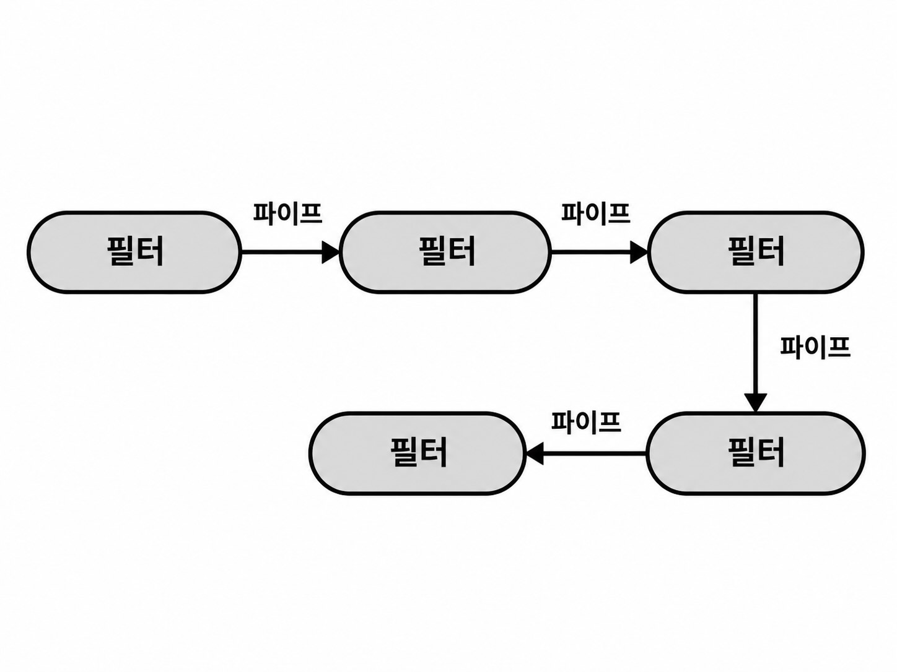
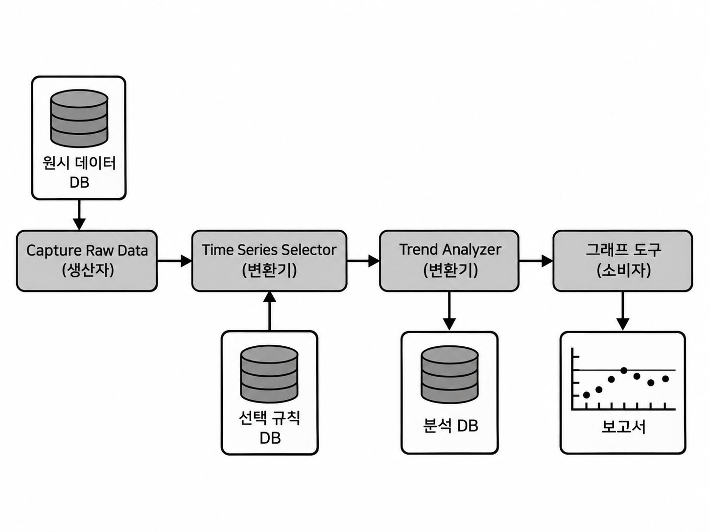
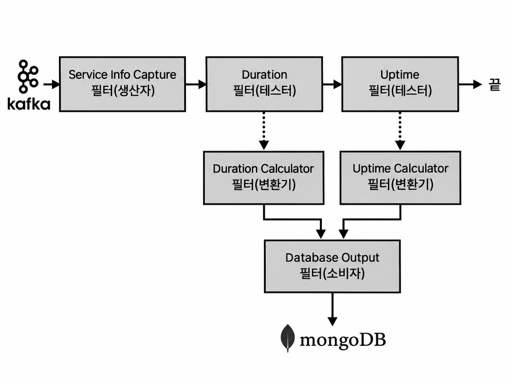

## 12. 파이프라인 아키텍처 스타일

- 파이프라인 아키텍처는 파이프와 필터(Pipe and Filter) 아키텍처라고도 한다.
- 기능을 여러 단계로 분리하고, 각 단계의 처리 결과를 다음 단계로 전달하는 구조이다.
- Unix의 Bash, Zsh에서 사용하는 `|` 파이프나 MapReduce 등에서도 비슷한 구조를 볼 수 있다.

### 12.1 토폴로지

파이프라인 아키텍처는 크게 **필터와 파이프**로 구성된다.

- 필터
    - 시스템의 기능을 수행하는 처리 단위이다.
    - 각각 구체적인 비즈니스 기능이나 데이터 처리를 담당한다.
- 파이프
    - 한 필터의 결과를 다음 필터로 전달하는 통신 경로이다.
- 일반적으로 필터들은 단방향 파이프로 연결되며 점대점(point-to-point) 방식으로 통신한다.
- 전체적으로는 여러 필터가 순차적으로 연결된 하나의 처리 흐름을 구성한다.

### 12.2 스타일 세부 사항

- 대부분의 파이프라인 아키텍처는 하나의 애플리케이션으로 배포되는 모놀리스 형태이다.
- 하지만 필터 또는 필터 집합을 각각 서비스로 배포할 수도 있다.
    - 이 경우 서비스 간 동기 또는 비동기 통신을 이용해 분산 아키텍처로 구성할 수 있다.
- 배포 방식과 관계없이 핵심 구성요소는 필터와 파이프이다.

#### 12.2.1 필터

필터는 다른 필터와 독립적으로 동작하는 자기완결적인 기능 단위이다.
- 일반적으로 상태를 가지지 않는다.
- 하나의 필터는 하나의 작업에 집중한다.
- 복잡한 처리는 하나의 거대한 필터보다 여러 필터를 조합해서 처리한다.

필터는 네 가지 유형으로 나뉜다.

- 생산자(Producer)
    - 파이프라인의 시작점이다.
    - 외부 시스템이나 사용자 인터페이스 등에서 들어온 데이터를 파이프라인에 공급한다.
- 변환기(Transformer)
    - 입력 데이터의 일부 또는 전체를 변환하여 다음 파이프로 전달한다.
    - 데이터 보강, 변환, 계산 등에 사용한다.
- 테스터(Tester)
    - 입력 데이터를 특정 조건에 따라 검사한다.
    - 조건에 따라 데이터를 다음 단계로 전달할지 결정하거나 선택적으로 결과를 생성한다.
- 소비자(Consumer)
    - 파이프라인의 마지막 처리 단계이다.
    - 결과를 데이터베이스에 저장하거나 UI, 보고서 등으로 출력한다.

각 필터는 독립적인 작은 기능을 담당하므로 여러 필터를 원하는 순서로 연결하여 조합적으로 재사용(compositional reuse)하기 쉽다.

- Unix 셸에서 작은 명령어들을 `|`로 연결하여 복잡한 작업을 수행하는 방식이 대표적인 예이다.

#### 12.2.2 파이프

- 파이프는 필터와 필터 사이의 통신 경로이다.
- 일반적으로 한 방향으로만 데이터를 전달한다.
- 전달되는 페이로드(payload)의 형식 자체는 아키텍처에서 정해져 있지 않다.
- 다만 높은 성능을 유지하기 위해 가능한 적은 양의 데이터를 전달하도록 설계하는 경우가 많다.

배포 방식에 따라 다양한 통신 방법을 사용할 수 있다.

- 분산 환경: REST, 메시징, 스트리밍, 기타 원격 통신 프로토콜
- 모놀리스 환경: 직접 호출, 스레드, 내부/내장 메시징

따라서 파이프라인 아키텍처는 모놀리스/분산, 동기/비동기 방식을 모두 사용할 수 있다.

### 12.3 데이터 토폴로지

- 파이프라인 아키텍처는 대부분 모놀리스로 배포되기 때문에 하나의 데이터베이스를 사용하는 구조를 떠올리기 쉽다.
- 하지만 반드시 단일 데이터베이스를 사용해야 하는 것은 아니다.
- 전체 파이프라인이 하나의 데이터베이스를 공유할 수도 있고, 각 필터가 자신의 역할에 필요한 별도의 데이터베이스를 사용할 수도 있다.

예시
- 생산자 필터가 원시 데이터 DB에서 데이터를 가져온다.
- 변환기 필터가 별도의 규칙 DB를 이용해 데이터를 선택한다.
- 다음 변환기가 분석한 결과를 분석 DB에 저장한다.
- 마지막 소비자가 결과를 이용해 보고서를 생성한다.

즉, 파이프라인의 처리 흐름과 데이터 저장 구조는 서로 독립적으로 설계할 수 있다.

### 12.4 클라우드 환경 고려 사항

- 파이프라인 아키텍처는 모듈성이 높고 필터가 역할별로 분리되어 있어 클라우드 기반 배포와 잘 맞는다.
- 전체를 하나의 모놀리스로 배포할 수도 있고, 각 필터나 필터 집합을 별도의 서비스로 분산 배포할 수도 있다.
    - 분산 환경에서는 각 필터를 서버리스 함수나 컨테이너 등으로 구현할 수 있다.
- 구조 자체가 비교적 단순하고 각 필터의 책임 범위도 좁아 클라우드 환경에 적용하기 어렵지 않다.
- AWS에서는 Step Functions와 Lambda를 조합해 각 필터를 작업 단계로 구성할 수 있다.
    - 다만 반드시 이런 방식으로 구현해야 하는 것은 아니며, 여러 필터를 하나의 서비스로 묶어 배포하는 것도 가능하다.

### 12.5 일반적인 위험

#### 필터에 너무 많은 책임을 부여하는 경우

- 파이프라인의 목적은 기능을 단일 목적의 필터들로 분리하는 것이다.
- 하나의 필터가 여러 역할을 담당하기 시작하면 관심사 분리가 깨지고 구조가 복잡해진다.

#### 양방향 통신을 사용하는 경우

- 파이프는 기본적으로 단방향 통신을 전제로 한다.
- 필터끼리 양방향으로 통신하기 시작하면 결합도가 높아지고 필터의 독립성이 약해진다.
- 양방향 통신이 반드시 필요하다면 파이프라인 아키텍처가 적합한 스타일인지 다시 검토할 필요가 있다.

#### 오류 처리와 복구

- 파이프라인 처리 도중 오류가 발생하면 어느 지점에서 종료하고 어떻게 복구할지 결정하기 어렵다.
- 따라서 발생 가능한 주요 오류 조건과 복구 방법을 미리 정의해야 한다.

#### 필터 간 계약

- 파이프를 통해 전달되는 데이터의 형식과 내용을 필터 간 계약으로 정의해야 한다.
- 한 필터가 계약을 변경하면 다음 필터가 오작동할 수 있으므로 엄격한 테스트와 관리가 필요하다.

### 12.6 거버넌스

- 필터의 역할과 책임이 제대로 지켜지지 않으면 파이프라인이 비구조적인 모놀리스로 변질될 수 있다.
- 따라서 생산자, 변환기, 테스터, 소비자와 같은 필터 유형별 책임을 명확히 유지해야 한다.
- 필터가 실제로 자신의 역할만 수행하는지를 완전히 자동으로 검사하는 적합성 함수를 만들기는 어렵다.

이를 보완하기 위해 필터의 유형을 메타데이터로 명시할 수 있다.

- Java에서는 어노테이션을 이용할 수 있다.
    - 예시) `@Filter(FilterType.TRANSFORMER)`
- 이를 통해 해당 클래스가 어떤 종류의 필터인지 명확하게 표현할 수 있다.
- 복잡한 필터는 여러 클래스로 구성될 수 있으므로 필터의 진입점(entry point)을 표시하는 별도의 어노테이션도 사용할 수 있다.

이런 방식은 개발자의 실수를 완전히 막지는 못하지만, 필터의 역할과 책임을 명확히 표현하고 검증하는 데 도움이 된다.

### 12.7 팀 토폴로지 고려 사항

파이프라인 아키텍처는 모듈성이 높고 각 필터가 독립적인 역할을 가지므로 여러 팀 구조와 비교적 잘 맞는다.

- 스트림 정렬 팀
    - 하나의 처리 흐름 전체를 담당하기 좋다.
- 활성화 팀
    - 기존 파이프라인을 방해하지 않고 새로운 필터를 실험하거나 추가하기 쉽다.
- 난해한 하위시스템 팀
    - 복잡한 필터를 별도의 전문 팀이 담당하기 좋다.
- 플랫폼 팀
    - 공통 도구, 서비스, API 등을 여러 필터와 팀에서 재사용할 수 있다.

### 12.8 스타일 특성

- 파이프라인 아키텍처는 애플리케이션 로직을 필터 유형별로 나누므로 기술적 분할 방식의 아키텍처이다.
- 일반적으로 하나의 모놀리스 배포 단위로 구현되므로 아키텍처 퀀텀 수도 보통 1개이다.

장점
- 비용이 낮다.
    - 분산 아키텍처가 아니므로 구축과 운영이 비교적 단순하고 유지보수 비용도 낮다.
- 단순성이 높다.
    - 필터와 파이프라는 단순한 구조로 이루어져 이해하기 쉽다.
- 모듈성이 높다.
    - 각 필터가 독립적인 역할을 수행하므로 관심사가 잘 분리된다.
    - 특정 필터를 수정하거나 교체해도 다른 필터에 미치는 영향을 줄일 수 있다.

배포성과 테스트성
- 배포성과 테스트성은 평균 수준이며 계층형 아키텍처보다는 조금 낫다.
    - 필터 단위로 관심사가 잘 분리되어 있기 때문이다.
- 하지만 일반적으로 모놀리스 배포이므로 다음과 같은 단점이 남아 있다.
    - 배포 의례(ceremony): 배포를 위한 절차와 준비 작업이 커질 수 있음
    - 배포 위험 증가
    - 낮은 배포 빈도
    - 전체 테스트 범위 증가

확장성과 탄력성
- 일반적인 모놀리스 방식에서는 확장성과 탄력성이 낮다.
- 필터를 개별 서비스로 배포하고 비동기 통신을 사용하면 이러한 특성을 크게 개선할 수 있다.
- 대신 분산 아키텍처가 되면서 비용과 복잡성이 증가한다.

내결함성과 가용성
- 모놀리스로 배포하면 내결함성이 낮다.
    - 한 필터에서 메모리 부족 같은 장애가 발생하면 애플리케이션 전체가 종료될 수 있다.
- 모놀리스 특성상 평균 복구 시간(MTTR)과 시동 시간이 길어져 가용성에도 불리하다.
- 각 필터를 별도 배포 단위로 분산시키면 내결함성과 가용성을 높일 수 있지만 역시 비용과 복잡성이 증가한다.

즉, 낮게 평가되는 운영 특성들은 필터를 개별 배포하고 파이프를 원격/비동기 통신으로 구현하여 개선할 수 있다.
- 대신 단순성과 저비용이라는 기존 장점을 일부 포기해야 한다.
- 전형적인 아키텍처 트레이드오프이다.

#### 12.8.1 언제 사용하면 좋은가

- 처리 단계가 명확하게 구분되어 있을 때
- 처리 순서가 비교적 고정되어 있을 때
- 데이터가 한 방향으로 흐르는 결정론적 작업흐름일 때
- 구조가 단순하므로 시간과 예산이 제한된 시스템에도 잘 맞는다.

대표적으로
- EDI(Electronic Data Interchange)
- ETL(Extract-Transform-Load)

처럼 데이터를 단계별로 변환하고 전달하는 작업에 잘 맞는다.

#### 12.8.2 사용하지 말아야 할 때

- 높은 확장성, 탄력성, 내결함성이 중요한 시스템에는 모놀리스 방식의 파이프라인이 적합하지 않다.
    - 필요하다면 분산 파이프라인으로 개선할 수 있지만 복잡성이 증가한다.

- 양방향 통신이 필요한 작업에는 잘 맞지 않는다.
    - 파이프라인은 기본적으로 단방향 흐름을 전제로 하기 때문이다.

- 처리 흐름이 비결정적이고 분기가 많은 경우에도 적합하지 않다.
    - 테스터 필터가 계속 추가되면서 여러 경로로 분기하면 구조가 지나치게 복잡해질 수 있다.
    - 그 결과 유지보수성, 테스트성, 배포성이 나빠지고 전체 신뢰성에도 영향을 줄 수 있다.
    - 이런 종류의 비결정적 작업흐름에는 이벤트 주도 아키텍처가 더 적합할 수 있다.

### 12.9 예시와 용례

파이프라인 아키텍처는 단계별 데이터 처리가 필요한 시스템에서 자주 사용된다.

예시
- EDI: 문서를 여러 단계의 파이프와 필터를 거쳐 다른 형식으로 변환
- ETL: 데이터를 추출하고 변환한 후 다른 저장소에 적재
- Apache Camel 같은 통합 도구도 단계별 정보 전달에 파이프라인 방식을 활용한다.

책의 예제에서는 Kafka로 들어오는 서비스 원격 측정(telemetry) 데이터를 파이프라인으로 처리한다.

- Service Info Capture
    - Kafka 토픽에서 데이터를 받아오는 생산자 필터
- Duration
    - 데이터가 서비스 요청 시간과 관련 있는지 검사하는 테스터 필터
- Duration Calculator
    - 요청 시간을 계산하는 변환기 필터
- Uptime
    - 가동 시간 지표와 관련 있는지 검사하는 테스터 필터
- Uptime Calculator
    - 가동 시간을 계산하는 변환기 필터
- Database Output
    - 처리된 결과를 MongoDB에 저장하는 소비자 필터

필터의 역할이 명확하게 분리되어 있기 때문에 새로운 지표가 필요하면 기존 흐름 전체를 수정하기보다 새로운 테스터/변환기 필터를 추가하여 확장할 수 있다.

핵심
- 파이프라인 아키텍처는 단순한 단방향 처리 흐름을 작은 단일 책임 필터들로 조합하는 데 강하다.
- 하지만 흐름이 복잡하게 분기하거나 양방향 통신이 많아지면 이 스타일의 장점이 빠르게 사라진다.