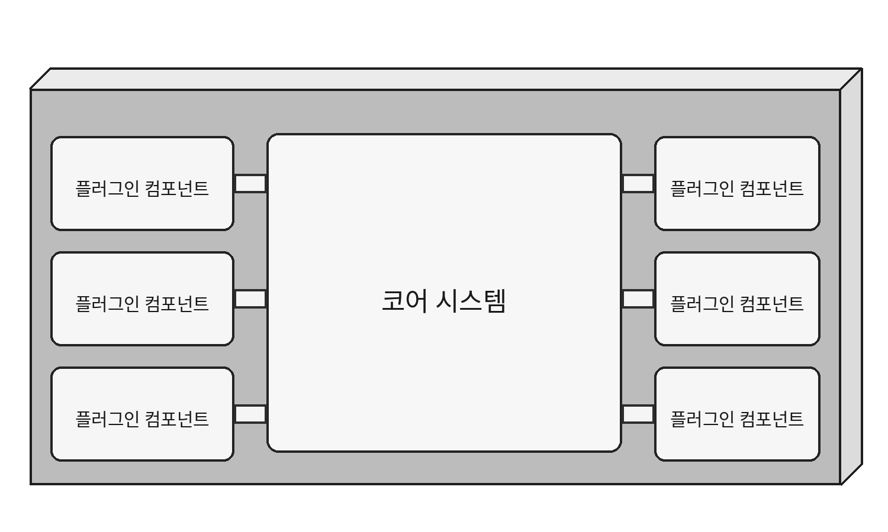
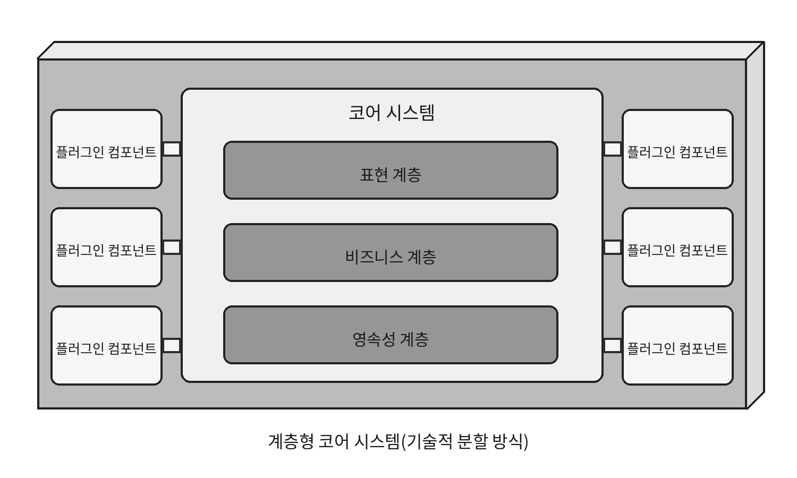
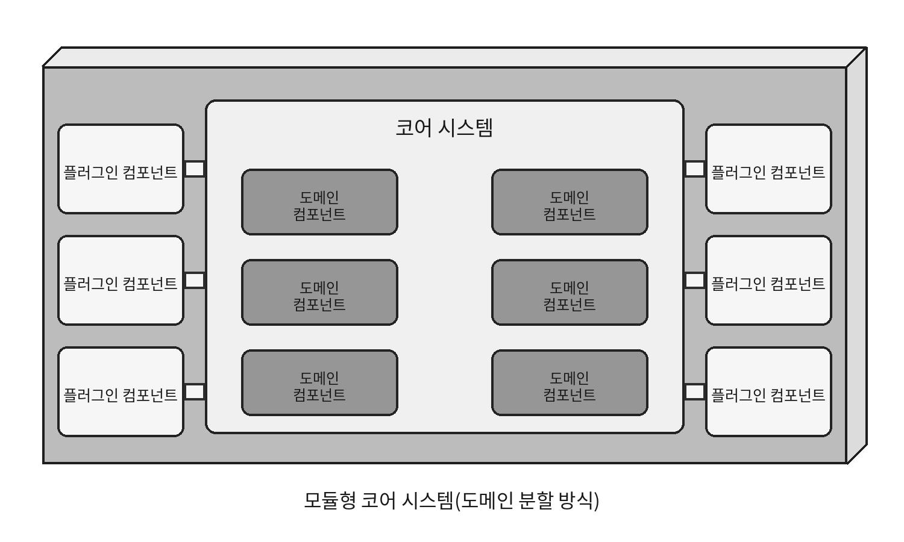
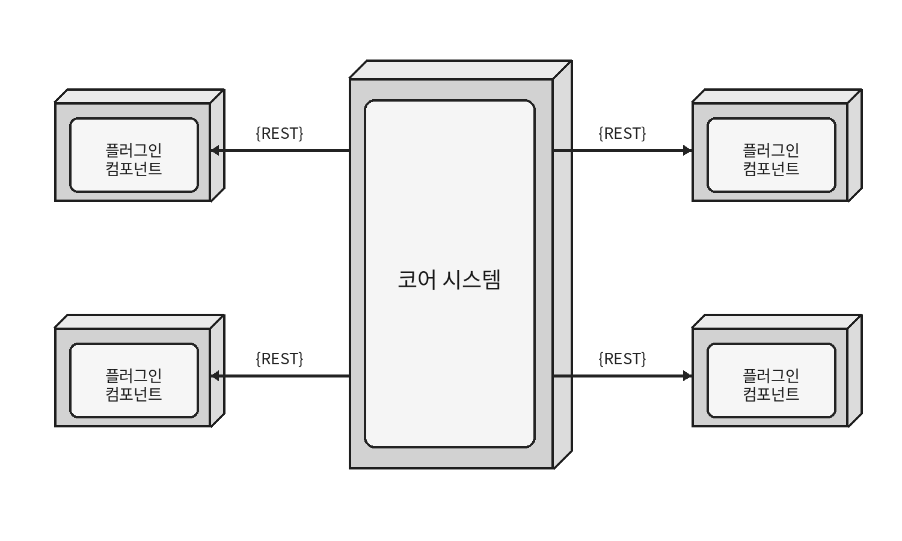
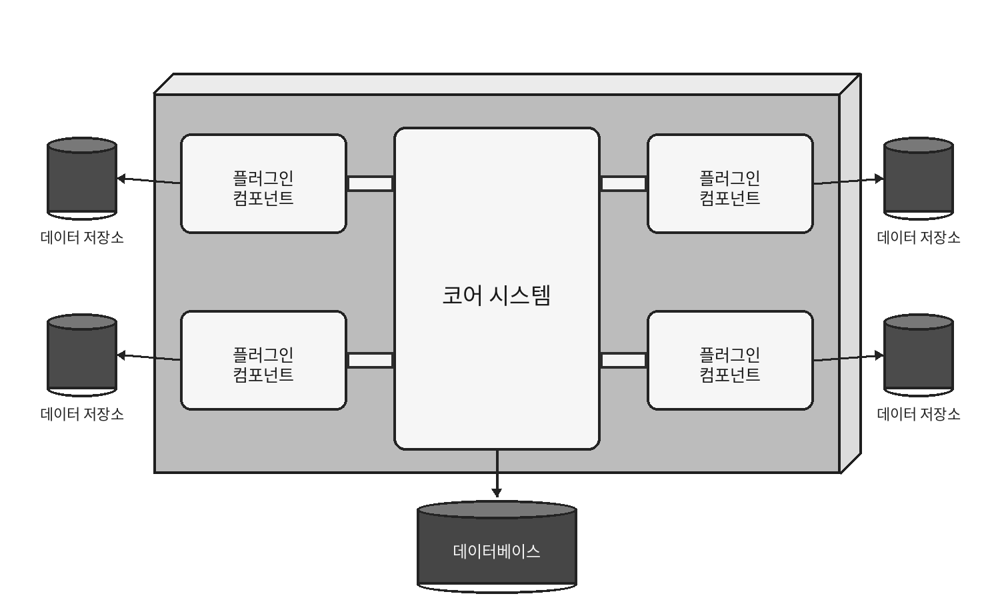

## 13. 마이크로커널 아키텍처 스타일
- 제품 기반 애플리케이션에 잘 어울린다.
- 코어 시스템 + 플러그인 형태로 구성된다.
- 설치형 제품이나 고객별 커스터마이징이 필요한 시스템에 적합하다.
    - 예: IDE, 브라우저, 고객별 규칙이 다른 업무 시스템

### 13.1 토폴로지

- 크게 두 부분으로 나뉜다.
    - 코어 시스템
    - 플러그인 컴포넌트
- 공통적이고 안정적인 기능은 코어에 두고, 특화되거나 변동성이 높은 기능은 독립적인 플러그인으로 분리한다.

### 13.2 스타일 세부 사항

#### 13.2.1 코어 시스템
- 일반적인 해피 패스 / 정상 처리 흐름을 담당한다.
- 복잡하거나 자주 변경되는 기능은 플러그인으로 빼낸다.
    - 코어의 복잡도가 낮아짐
    - 유지보수성과 테스트성 향상
    - 새로운 기능 확장이 쉬워짐
- 예제처럼 기기별 `if-else` 분기를 코어에 계속 추가하는 대신, 기기에 맞는 플러그인을 찾아 실행하도록 만들 수 있다.
- 코어는 `DevicePlugin` 같은 공통 인터페이스(계약) 는 알고 있다.
    - 대신 `iPhone6Plugin`, `Galaxy5Plugin` 같은 구체 구현의 내부 로직까지 알 필요는 없다.

코어 시스템 자체의 내부 구조도 여러 방식으로 구성할 수 있다.

- 계층형 코어 시스템
    - 표현 / 비즈니스 / 영속성 등 기술적으로 분할

- 모듈형 코어 시스템
    - 도메인별로 분할

UI도 다양하게 배치할 수 있다.
- 코어 안에 포함된 UI
- 별도로 배포되는 UI
- 별도 UI 자체도 마이크로커널 구조로 구성

#### 13.2.2 플러그인 컴포넌트

- 특화 처리, 추가 기능, 고객별 기능, 변동성이 높은 코드를 격리한다.
- 이상적으로 플러그인끼리는 서로 의존하지 않는다.

코어와 플러그인은 일반적으로 점대점 방식으로 통신한다.

- 코어가 플러그인의 메서드나 함수를 직접 호출
- 연결 방식
    - 컴파일 시점 플러그인
    - 실행 시점 플러그인
- 실행 시점 플러그인은 전체 시스템을 다시 배포하지 않고 추가/제거할 수 있다는 장점이 있다.

플러그인 구현 방법은 여러 가지다.

- JAR, DLL, Ruby Gem 등의 공유 라이브러리
- 패키지 / namespace

JAR과 패키지
- JAR -> 물리적으로 코드를 분리하는 단위
- 패키지(package) -> 코드 내부를 논리적으로 구분하는 방법

##### 원격 플러그인

플러그인을 별도의 서비스로 만들고 REST나 메시징으로 호출할 수도 있다.

장점
- 코어와 플러그인의 결합도 감소
- 플러그인별 독립 배포/확장 가능
- 확장성과 처리량 향상
- 비동기 처리를 통해 사용자 반응성 개선 가능

단점
- 시스템이 분산형으로 변하면서 복잡성과 비용 증가
- 배포 토폴로지가 복잡해짐
- 네트워크 장애를 고려해야 함
- 플러그인 서비스가 죽거나 응답하지 않으면 요청을 완료하지 못할 수 있음

기본 마이크로커널은 보통 모놀리스라 아키텍처 퀀텀이 1개인 경우가 많다.

하지만 원격 플러그인을 독립 서비스로 분리하면 독립적인 배포 단위와 아키텍처 퀀텀이 늘어날 수 있으므로, 무조건 하나라고 보는 것은 아니다.

#### 13.2.3 마이크로커널성의 스펙트럼

마이크로커널성은 전체 기능 중 코어가 얼마나 담당하는가에 따라 달라진다.
- Eclipse IDE
    - 코어 기능이 작고 많은 기능이 플러그인에 있음
    - 마이크로커널성이 높음
- 웹 브라우저
    - 플러그인이 없어도 자체적으로 많은 기능을 제공
    - 마이크로커널성이 상대적으로 낮음

즉,
- 코어 기능 적음 / 플러그인 기능 많음 → 마이크로커널성 높음
- 코어 기능 많음 → 마이크로커널성 낮음

#### 13.2.4 레지스트리

코어는 어떤 플러그인이 있고 어떻게 접근해야 하는지 알아야 한다.

이를 위해 플러그인 레지스트리**를 사용한다.

레지스트리에는 다음과 같은 정보가 들어갈 수 있다.

- 플러그인 이름, 플러그인 위치, 데이터 계약, 메시징 정보, REST 엔드포인트 등 원격 접근 정보

간단한 경우에는 Map으로 구현할 수 있고, 복잡한 환경에서는 ZooKeeper나 Consul 같은 외부 도구를 사용할 수도 있다.

#### 13.2.5 계약

코어와 플러그인은 서로 통신하기 위한 계약이 필요하다.

계약에는 다음이 포함된다.

- 어떤 기능을 제공하는지
- 입력 데이터 형식
- 출력 데이터 형식
- 플러그인의 기본 동작 방식

Java라면 AssessmentPlugin 같은 인터페이스로 계약을 정의할 수 있다.

서드파티 플러그인이 코어의 표준 계약과 다른 규격을 사용하는 경우에는 코어를 서드파티마다 수정하지 않고 어댑터(adapter)를 둔다.

코어의 표준 계약 -> 어댑터 -> 서드파티 플러그인

즉, 코어는 항상 자신의 표준 계약만 사용하고, 서로 다른 서드파티 규격은 어댑터가 변환한다.

### 13.3 데이터 토폴로지

- 일반적으로 하나의 중앙 데이터베이스를 사용한다.
- 플러그인이 DB에 직접 접근하기보다 코어가 데이터를 조회해서 플러그인에 전달하는 방식이 흔하다.
    - 데이터 구조가 변경되어도 플러그인보다 코어가 주로 영향을 받는다.
- 필요하다면 플러그인마다 별도 데이터 저장소를 둘 수도 있다.
    - 외부 DB
    - 인메모리/내장형 DB 등

### 13.4 클라우드 고려 사항

- 전체 애플리케이션을 클라우드에 배포할 수 있다.
- 데이터만 클라우드에 둘 수도 있다.
- 코어는 온프레미스에 두고 플러그인만 클라우드 서비스로 분리할 수도 있다.
    - 확장성과 독립 배포에는 유리
    - 대신 네트워크 지연과 통신 오버헤드 때문에 반응성이 나빠질 수 있음

### 13.5 일반적인 위험

#### 변동성이 높은 코어 시스템

- 마이크로커널의 핵심은 안정적인 코어 + 변동성이 높은 플러그인이다.
- 코어가 계속 변경된다면 기능 분리가 잘못된 것일 수 있다.
- 자주 변경되는 기능은 플러그인으로 빼는 것이 좋다.

#### 플러그인 의존성

- 이상적으로 플러그인끼리는 서로 의존하지 않아야 한다.
- 플러그인 간 조정이 필요하면 코어가 담당하는 것이 좋다.
- 피할 수 없이 의존성이 생기면 버전 충돌이나 전이적 의존성 관리가 복잡해진다.

### 13.6 거버넌스

마이크로커널 구조가 제대로 유지되는지 확인하는 것이 핵심이다.

- 코어 시스템이 얼마나 자주 변경되는지 확인
- 코어와 플러그인의 계약 테스트
- 이전 버전 플러그인과의 호환성 확인
- 플러그인끼리 불필요하게 의존하지 않는지 확인
- 전체 토폴로지가 처음 의도한 구조를 유지하는지 검증

### 13.7 팀 토폴로지 고려 사항

- 코어 시스템 팀과 플러그인 팀으로 역할을 나누기 좋다.
- 복잡한 특화 기능은 별도 플러그인 팀이 담당할 수 있다.
- 플랫폼 팀은 공통 운영, 배포, 인프라 등을 지원할 수 있다.

### 13.8 아키텍처 특성 등급 평가

장점
- 비용과 단순성이 좋다.
- 모듈성, 테스트성, 배포성, 진화성이 비교적 좋다.
    - 기능이 플러그인 단위로 격리되기 때문
- 기술적 분할과 도메인 분할 모두 가능하다.
    - 계층형 코어 -> 기술적 분할
    - 지역/고객/제품별 플러그인 -> 도메인 분할
- 반응성도 비교적 좋다.
    - 코어를 작고 단순하게 유지하고 불필요한 기능을 플러그인으로 분리할 수 있기 때문

단점
- 기본적으로 모놀리스이므로 확장성, 탄력성, 내결함성은 높지 않다.
- 원격 플러그인으로 분산하면 개선할 수 있지만 비용과 복잡성이 증가한다.

모듈성과 진화성이 특히 강점이다.

- 플러그인은 독립적이고 자기완결적이므로 기능을 추가, 제거, 변경하기 쉽다.
- 예를 들어 세금 양식이나 지역 규칙이 변경되면 해당 플러그인만 교체할 수 있다.

### 13.9 예시와 용례

대표적인 예
- Eclipse, Jira, Jenkins, PMD, 브라우저의 확장 프로그램

또한 고객이나 지역마다 규칙이 달라지는 업무에도 잘 맞는다.

#### 세금 처리
- 공통 처리 -> 코어
- 지역별 세금 규칙 -> 플러그인

세법이 변경되어도 해당 지역 플러그인만 수정하면 된다.

#### 보험 청구
- 모든 지역의 보험 규칙을 하나의 거대한 규칙 엔진에 넣으면 변경 영향이 커지고 구조가 복잡해질 수 있다.
- 관할구역별 규칙을 각각 플러그인으로 분리하면 변경을 해당 영역에 격리할 수 있다.

### 커스터마이징과 마이크로커널
마이크로커널은 커스터마이징이 많은 시스템과 잘 맞는다.
- 공통 기능 ->코어
- 고객/지역/제품마다 달라지는 기능 -> 플러그인

즉,
공통 기능은 유지하면서 일부 기능만 상황에 따라 갈아 끼워야 할 때 적합한 아키텍처이다.