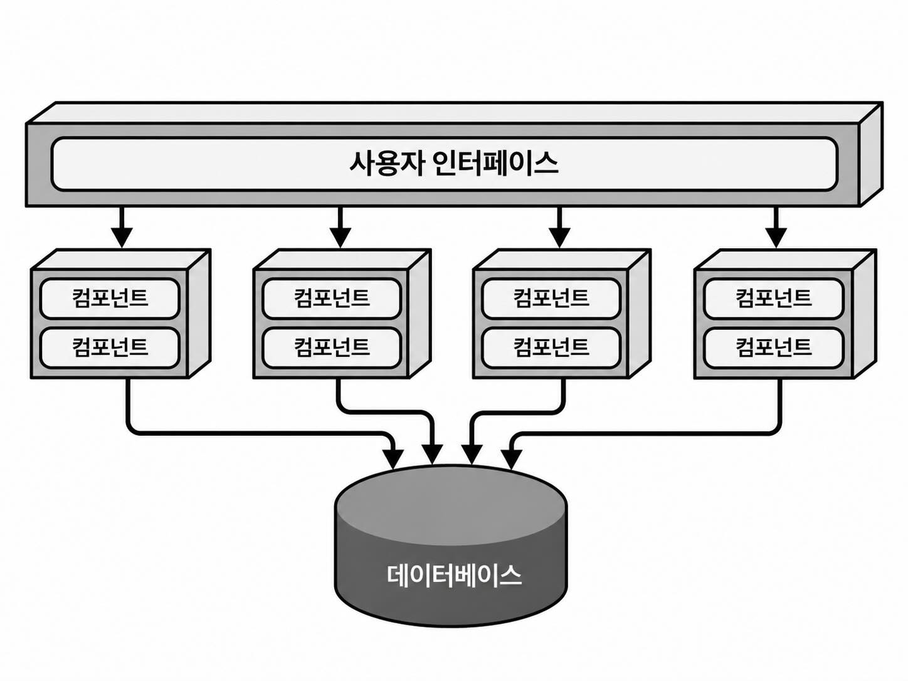
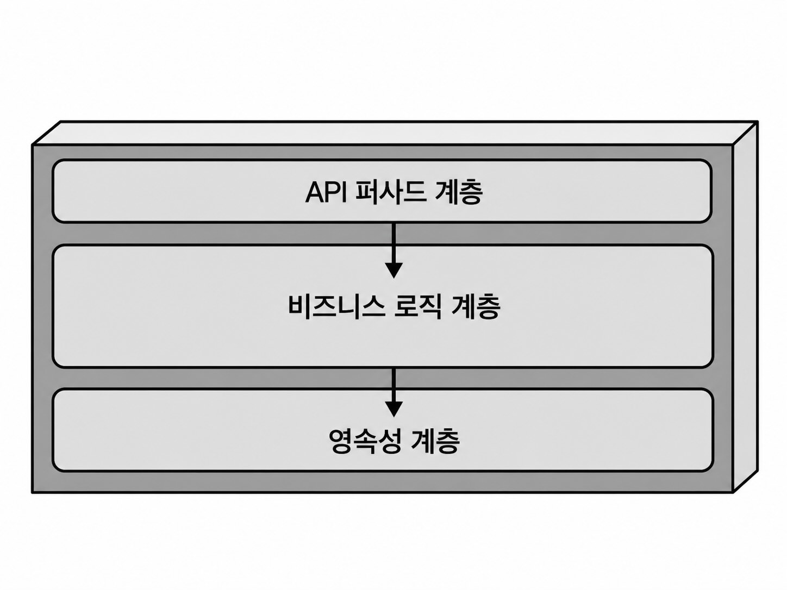
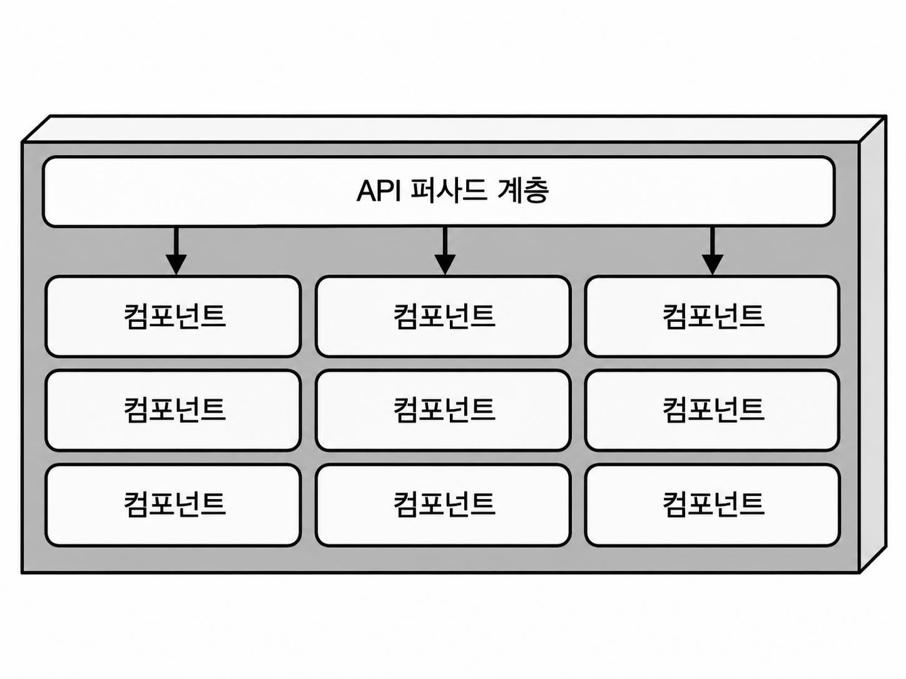

## 14. 서비스 기반 아키텍처 스타일

- 서비스 기반 아키텍처는 마이크로서비스 아키텍처의 혼합 변형 중 하나이다.
- 분산 아키텍처이지만 마이크로서비스나 이벤트 주도 아키텍처보다 덜 복잡하고 비용도 낮아 실용적이다.
- 특히 유연성이 높은 편이며 비즈니스 애플리케이션에서 많이 사용된다.

### 14.1 토폴로지

기본적으로 다음으로 구성된다.

- 사용자 인터페이스
- 세분도가 낮은(coarse-grained) 여러 서비스
- 모놀리스형 공유 데이터베이스

#### 도메인 서비스

- 각 서비스는 시스템의 특정 도메인 또는 하위 도메인을 담당한다.
- 이런 서비스를 도메인 서비스라고 한다.
- 마이크로서비스보다 덩어리가 크고, 하나의 서비스가 비교적 많은 기능을 담당한다.
    - 예: 주문 이행, 주문 배송 등
- 각 도메인 서비스는 서로 독립적으로 동작하고 별도로 배포할 수 있다.
- 반드시 컨테이너를 사용할 필요는 없지만 필요하면 Docker/Kubernetes 같은 방식으로 배포할 수도 있다.

공유 모놀리스 데이터베이스를 사용하는 경우 서비스가 너무 많아지면 관리가 어려워지므로 도메인 서비스 수를 적게 유지하는 것이 좋다.
- 책에서는 12개 이하를 권장한다.

#### 서비스 인스턴스

- 일반적으로 하나의 도메인 서비스는 하나의 인스턴스로 배포한다.
- 하지만 확장성, 내결함성, 처리량이 필요하면 같은 서비스의 인스턴스를 여러 개 둘 수 있다.
- 이 경우 UI와 서비스 사이에 로드 밸런싱 수단을 두어 요청을 정상적인 서비스 인스턴스로 분산한다.

#### UI와 서비스 통신

UI는 다음과 같은 방법으로 도메인 서비스를 호출할 수 있다.

- REST, RPC, SOAP, 프록시, API Gateway 등을 포함한 API 계층

UI가 직접 서비스를 찾아 호출하도록 서비스 로케이터 패턴을 사용할 수도 있고, 서비스 탐색 기능을 API Gateway나 프록시 쪽에 둘 수도 있다.

#### 데이터베이스

- 일반적으로 하나의 중앙 공유 모놀리스 데이터베이스를 사용한다.
- 기존 모놀리스와 비슷하게 서비스가 SQL의 JOIN 등을 자유롭게 사용할 수 있다.
- 서비스 수가 많지 않으므로 데이터베이스 커넥션 부족 문제도 상대적으로 적다.
- 대신 여러 서비스가 하나의 DB를 공유하므로 스키마 변경 관리가 까다로울 수 있다.

### 14.2 스타일 세부 사항

서비스 기반 아키텍처의 도메인 서비스는 마이크로서비스보다 세분도가 낮다.

도메인 서비스 내부는 크게 두 가지 방식으로 구성할 수 있다.

#### 계층형 구조

하나의 도메인 서비스를 다음과 같이 나눈다.

- API 퍼사드 계층
- 비즈니스 로직 계층
- 영속성 계층

#### 도메인 분할 구조

- 하나의 도메인 서비스 내부를 여러 하위 도메인 컴포넌트로 나눌 수도 있다.
- 이 구조는 모듈형 모놀리스와 비슷하다.

즉, 서비스 기반 아키텍처는 서비스 자체는 도메인 단위로 크게 나누고, 각 서비스 내부 구조는 계층형이나 모듈형으로 자유롭게 구성할 수 있다.

#### API 퍼사드

API 퍼사드는 각 도메인 서비스에 속하는 진입점이다.

즉, 시스템 전체를 감싸는 하나의 거대한 퍼사드라는 의미가 아니다.

예를 들어 OrderService가 있다면

`UI -> OrderService의 API 퍼사드 -> OrderService 내부 비즈니스 로직`

형태가 된다.

API 퍼사드의 역할은 UI에서 들어온 하나의 비즈니스 요청을 받아 해당 도메인 서비스 내부의 여러 작업을 조율하는 것이다.

예를 들어 사용자가 상품을 주문하면 OrderService의 퍼사드가 내부적으로

- 주문 등록
- 주문 ID 생성
- 결제 적용
- 품목별 재고 갱신

등을 조율할 수 있다.

마이크로서비스에서는 이런 기능들이 여러 개의 독립 서비스로 나뉘어 서로 통신해야 할 수 있지만,

서비스 기반 아키텍처에서는 하나의 큰 도메인 서비스 내부에서 처리한다.

즉,

- 서비스 기반 -> 서비스 내부 조율
- 마이크로서비스 -> 여러 서비스 간 조율

이라는 차이가 있다.

#### 트랜잭션

도메인 서비스의 세분도가 크기 때문에 하나의 비즈니스 작업이 하나의 서비스 안에서 끝나는 경우가 많다.

따라서 일반적인 데이터베이스의 ACID 트랜잭션과 롤백을 사용할 수 있고, 하나의 도메인 서비스 안에서 데이터 무결성을 비교적 쉽게 유지할 수 있다.

반대로 마이크로서비스처럼 기능이 여러 작은 서비스로 분리되면 하나의 비즈니스 작업이 여러 서비스와 데이터베이스에 걸칠 수 있다.

이 경우 하나의 로컬 ACID 트랜잭션만으로 전체 작업을 되돌릴 수 없으므로 BASE나 보상 갱신 같은 분산 트랜잭션 기법이 필요할 수 있다.

#### 전자상거래 예시

고객이 상품 주문 후 결제를 시도했는데 신용카드가 만료되었다고 하자.

**서비스 기반 아키텍처**

- 주문 생성과 결제 처리가 하나의 큰 도메인 서비스 안에 있다.
- 결제가 실패하면 같은 데이터베이스 트랜잭션 안에서 지금까지 처리한 내용을 rollback할 수 있다.
- 주문과 결제 상태를 일관되게 유지하기 쉽다.

**마이크로서비스 아키텍처**

- OrderPlacement가 주문을 생성한다.
- 이후 별도의 PaymentService를 원격 호출한다.
- 그런데 결제가 실패하면 이미 주문 데이터는 저장된 상태일 수 있다.
- 따라서 단순한 DB 롤백으로 전체 작업을 되돌릴 수 없다.
- 주문을 취소하는 등의 보상 갱신(compensating update) 이 추가로 필요하다.

즉, 서비스 기반 아키텍처는 서비스가 크기 때문에 변경 영향 범위는 넓어질 수 있지만, 그 대신 하나의 비즈니스 작업을 한 서비스와 한 트랜잭션 안에서 처리하기 쉽다는 장점이 있다.

#### 14.2.1 서비스 설계와 세분도

- 서비스 기반 아키텍처의 도메인 서비스는 세분도가 낮고 하나의 서비스가 비교적 많은 기능을 담당한다.
- 덩어리가 크기 때문에 하나의 서비스 안에서 ACID 트랜잭션을 사용해 데이터 무결성과 일관성을 유지하기 쉽다.
- 대신 변경 범위도 커진다.
    - 예를 들어 OrderService의 주문 처리 기능을 변경해도 결제 등 같은 서비스에 포함된 다른 기능까지 함께 테스트하고 배포해야 할 수 있다.

반대로 마이크로서비스는 기능이 더 작고 세밀하게 나뉘어 있다.

- 주문 변경 -> OrderPlacement만 수정/테스트/배포
- PaymentService같은 다른 서비스는 영향을 덜 받음

즉,
- 서비스 기반: 큰 서비스 -> 트랜잭션과 일관성 관리에 유리하지만 변경 영향 범위가 큼
- 마이크로서비스: 작은 서비스 -> 변경 영향 범위는 작지만 서비스 간 조율이 복잡해짐

#### 14.2.2 사용자 인터페이스 옵션

서비스 기반 아키텍처에서는 UI도 여러 방식으로 구성할 수 있다.

- 단일 모놀리스 UI
    - 하나의 UI가 모든 도메인 서비스를 호출한다.
    - 가장 단순한 형태
- 도메인 기반 UI
    - 관련된 여러 도메인 서비스를 묶어 UI를 분리한다.
    - 예: 내부 운영 UI / 고객용 UI처럼 업무 영역 단위로 나눌 수 있다.
- 서비스 기반 UI
    - 각 도메인 서비스마다 별도의 UI를 둘 수 있다.
    - 서비스와 UI의 독립성이 가장 높지만 UI 개수가 늘어나 관리 복잡도도 증가한다.

UI도 서비스처럼 얼마나 크게 묶고 얼마나 잘게 나눌 것인지 선택할 수 있다.

#### 14.2.3 API 게이트웨이 옵션

UI와 도메인 서비스 사이에 리버스 프록시나 API Gateway를 둘 수 있다.

기본 구조는 다음과 같다.

`UI -> API Gateway / Reverse Proxy -> Domain Services`

API Gateway를 사용하는 이유는 다음과 같다.

- 도메인 서비스 기능을 외부 시스템에 노출
    - 외부 클라이언트가 내부 서비스에 직접 접근하지 않고 Gateway를 통해 필요한 API를 사용할 수 있게 한다.
    - 즉, 내부 서비스 주소나 구조를 외부에 직접 공개하지 않아도 된다.
- 공통 횡단 관심사 처리
    - 여러 서비스에서 공통으로 필요한 기능을 Gateway에서 처리할 수 있다.
    - 예) 인증/보안, 로깅/감사, 지표 측정, 서비스 발견
- 부하 분산
    - 같은 도메인 서비스의 인스턴스가 여러 개라면 Gateway나 Reverse Proxy가 요청을 여러 인스턴스로 분산할 수 있다.
    - 클라이언트는 각 인스턴스의 주소를 알 필요 없이 Gateway 하나만 호출하면 된다.
    - 장애 난 인스턴스를 제외하고 정상 인스턴스로 요청을 보낼 수도 있다.

### 14.3 데이터 토폴로지

- 서비스 기반 아키텍처는 분산 아키텍처이지만 모놀리스형 공유 데이터베이스를 효과적으로 사용할 수 있다.
- 반드시 하나의 데이터베이스만 사용해야 하는 것은 아니다.
    - 데이터베이스를 여러 개로 분리할 수도 있고
    - 도메인 서비스별로 별도의 데이터베이스를 둘 수도 있다.
- 다만 도메인 서비스별로 데이터베이스를 분리할 경우,
    - 한 서비스가 다른 서비스의 데이터를 필요로 하는지 확인해야 한다.
    - 필요하다면 서비스 간 통신이나 추가 데이터 공유 방식이 필요해질 수 있다.
    - 일반적으로 도메인 서비스가 다른 도메인 서비스를 호출하는 것보다 데이터를 공유하는 것이 낫다.

#### 공유 엔티티 라이브러리 문제

- 모든 데이터베이스 엔티티를 하나의 공유 라이브러리에 넣어 모든 서비스가 사용하면 결합도가 높아진다.
- 데이터베이스 스키마가 변경되면 해당 변경과 직접 관련 없는 서비스까지
    - 공유 라이브러리를 갱신하고, 다시 테스트하고, 재배포해야 할 수 있다.
- 따라서 하나의 거대한 엔티티 공유 라이브러리는 서비스 기반 아키텍처의 안티패턴이 될 수 있다.

#### 논리적 데이터베이스 분할

- 데이터베이스를 도메인별로 논리적으로 분리하고,
- 각 도메인에 해당하는 엔티티만 별도의 공유 라이브러리로 만든다.

예:
- customer_entities_lib
- invoicing_entities_lib
- order_entities_lib
- tracking_entities_lib

이렇게 하면 특정 도메인의 스키마 변경이 발생해도 그 도메인 라이브러리를 사용하는 서비스만 영향을 받는다.

#### 공통 데이터

- 여러 서비스에서 공통으로 사용하는 테이블이나 엔티티는 여전히 존재할 수 있다.
- 이런 경우 공통 라이브러리를 별도로 두고 사용할 수 있다.
- 공통 영역은 영향 범위가 크므로
    - 버전 관리를 적용하고
    - 변경 권한을 제한하는 등의 방식으로 엄격하게 관리하는 것이 좋다.