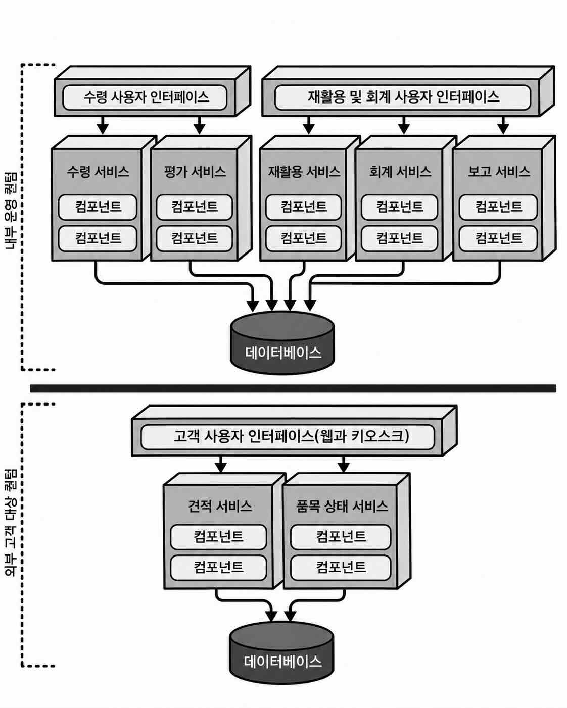
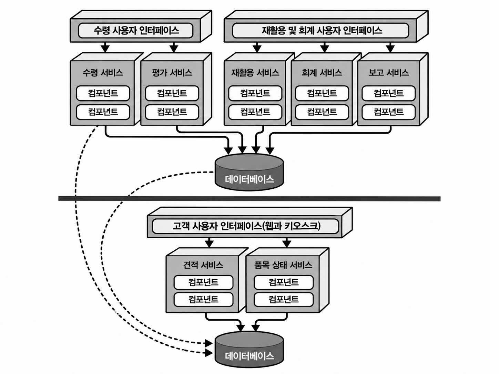

## 서비스 기반 아키텍처 스타일

### 14.4 클라우드 환경 고려 사항

- 서비스 기반 아키텍처는 분산 구조이므로 클라우드와 잘 어울린다.
- 도메인 서비스는 범위가 넓고 세분도가 낮기 때문에 서버리스 함수보다는 컨테이너로 구현하는 것이 일반적이다.
- 각 서비스는 클라우드의 파일 저장소, 데이터베이스, 메시징 서비스 등을 활용할 수 있다.

### 14.5 일반적인 위험

- 서비스 기반 아키텍처에서는 도메인 서비스 간 통신을 가능한 한 피하는 것이 좋다.
- 서비스 간 통신이 많다면
  - 도메인 경계를 잘못 나눴거나
  - 해당 문제에 이 아키텍처가 적합하지 않을 수 있다.
- 도메인 서비스를 너무 많이 만드는 것도 위험하다.
  - 서비스 수가 많아질수록 테스트, 배포, 모니터링, DB 연결 및 변경 관리가 복잡해진다.
  - 서비스 기반 아키텍처의 낮은 복잡성이라는 장점도 사라진다.

### 14.6 거버넌스

- 도메인 서비스는 가능한 한 독립적이어야 한다.
- 하나의 변경이 여러 도메인 서비스에 영향을 준다면 도메인 경계가 제대로 나뉘었는지 확인해야 한다.
- 서비스 간 통신이 불가피하다면 통신량과 의존성을 관리해야 한다.
- 여러 서비스를 함께 호출해야 하는 경우에는 UI나 API Gateway 수준에서 오케스트레이션 하도록 설계할 수 있다.
  - 상위 계층이 필요한 서비스들을 호출하고 전체 흐름을 조율하는 방식이다.

### 14.7 팀 토폴로지 고려 사항

서비스 기반 아키텍처는 기술별 팀보다 도메인 중심 팀과 잘 맞는다.

- 스트림 정렬 팀
  - 하나의 도메인에 집중하는 경우 잘 어울린다.
  - 여러 도메인 서비스를 넘나드는 작업이 많다면 서비스 경계를 다시 검토해야 한다.
- 활성화 팀
  - 서비스 기반 아키텍처와의 조합은 그리 효과적이지 않다.
  - 도메인 서비스의 세분도가 낮아 특정 기술이나 기능만 분리해 실험하기 어렵기 때문이다.
  - 다만 서비스 내부 컴포넌트를 세밀하게 구분했다면 일부 지원은 가능하다.
- 난해한 하위시스템 팀
  - 복잡한 도메인이나 하위 도메인을 별도로 맡아 처리하기 좋다.
- 플랫폼 팀
  - 공통 도구, 서비스, API, 배포 환경 등을 제공해 각 도메인 팀을 지원할 수 있다.

### 14.8 스타일 특성
- 서비스 기반 아키텍처는 도메인 분할 아키텍처이다.
- 특정 도메인의 변경은 해당 서비스와 관련 UI, DB에 주로 영향을 주고 다른 서비스에는 영향을 적게 준다.

#### 민첩성 / 테스트성 / 배포성
- 서비스별로 비교적 독립되어 있어 좋은 편이다.
- 특정 도메인의 변경을 해당 서비스 중심으로 테스트하고 배포할 수 있다.
- 모놀리스 전체를 다시 테스트하고 배포하는 것보다 영향 범위가 작다.

#### 내결함성과 가용성
- 도메인 서비스가 비교적 자기완결적이고 서비스 간 통신이 적어 좋은 편이다.
- 하나의 서비스가 중단되더라도 다른 서비스는 계속 동작할 수 있다.

#### 확장성과 탄력성
- 확장성과 탄력성은 아주 높은 편은 아니다.
- 도메인 서비스의 세분도가 낮아 특정 기능 하나만 따로 확장하기 어렵기 때문이다.
- 필요하다면 처리량이나 장애 대응을 위해 특정 서비스의 인스턴스를 여러 개 둘 수 있다.

#### 단순성과 비용

- 분산 아키텍처이지만 MSA나 이벤트 기반 아키텍처보다 단순하고 비용도 낮다.
- 서비스 수와 통신량이 상대적으로 적기 때문에 구현과 운영이 쉽다.
- 대신 확장성, 탄력성, 내결함성 등을 더 높이려면 인스턴스 추가나 복잡한 인프라가 필요해져 비용과 복잡성이 증가한다.

#### DDD와 트랜잭션

- 도메인 범위로 서비스를 나누므로 DDD와 잘 어울린다.
- 도메인의 변화도 해당 서비스에 집중해서 적용하기 쉽다.
- 서비스의 세분도가 낮아 하나의 비즈니스 작업이 하나의 도메인 서비스 안에서 끝나는 경우가 많다.
    - 따라서 일반적인 ACID commit / 롤백을 활용하기 쉽다.
- MSA처럼 여러 서비스와 DB에 걸친 작업은 최종 일관성이나 보상 처리를 더 많이 고려해야 한다.

#### 아키텍처 퀀텀

- 퀀텀 수는 항상 1개로 고정되지 않는다.
- UI와 데이터베이스를 어떻게 나누느냐에 따라 하나일 수도 있고 여러 개일 수도 있다.

### 14.9 예시와 용례

- 고잉 그린 시스템을 도메인별 독립 서비스로 분리한다.
- 트래픽이 많은 고객용 서비스는 인스턴스를 여러 개 두고, 내부 운영 서비스는 필요하면 하나만 유지한다.
- 도메인 분리 덕분에
    - 특정 서비스 장애가 다른 서비스로 전파되지 않아 내결함성, 가용성이 좋아진다.
    - 필요한 서비스만 확장할 수 있어 확장성도 좋아진다.
- 내부용/외부용 데이터베이스를 분리하고 내부 DB를 별도 네트워크 영역에 두어 보안을 강화할 수 있다.
    - 필요한 데이터가 있다면 테이블 미러링이나 동기화를 통해 일부 데이터만 공유할 수 있다.
    - 내부/외부 영역은 각각 독립적인 아키텍처 퀀텀을 형성할 수도 있다.
- 변경이 잦은 Assessment(평가) 서비스만 독립적으로 수정·테스트·배포할 수 있어 민첩성, 테스트성, 배포성이 좋아진다.
- 서비스 기반 아키텍처는 도메인 분할, 적절한 확장성, 내결함성, 가용성, 빠른 반응성을 비교적 낮은 비용과 복잡성으로 제공한다.

#### 분산 아키텍처로 가는 중간 단계

- 모놀리스에서 바로 MSA로 가기보다 서비스 기반 아키텍처를 중간 단계로 사용할 수 있다.
- 먼저 큰 도메인 단위로 분리한 뒤 실제 운영하면서
  - 더 잘게 쪼개야 하는 부분
  - 굳이 쪼갤 필요가 없는 부분 을 판단할 수 있다.
- 처음부터 모든 기능을 마이크로서비스로 만들면서 과도하게 세분화하는 문제를 줄일 수 있다.