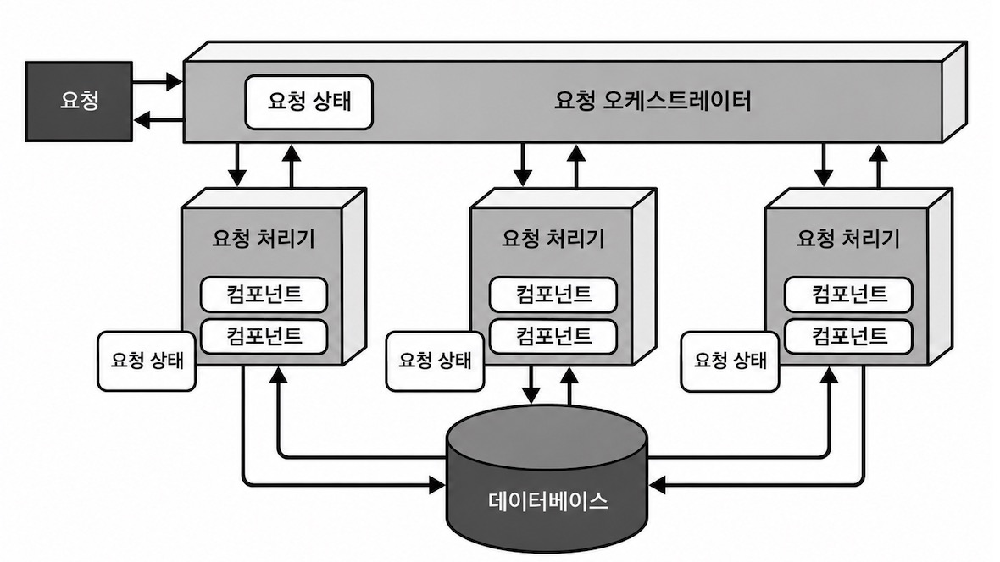
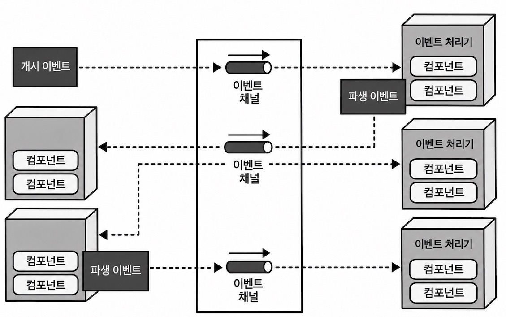
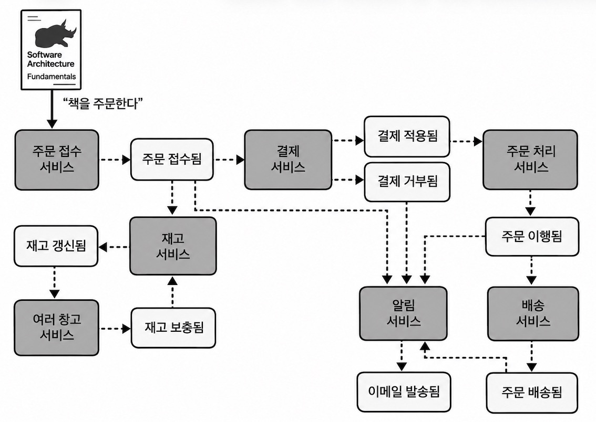
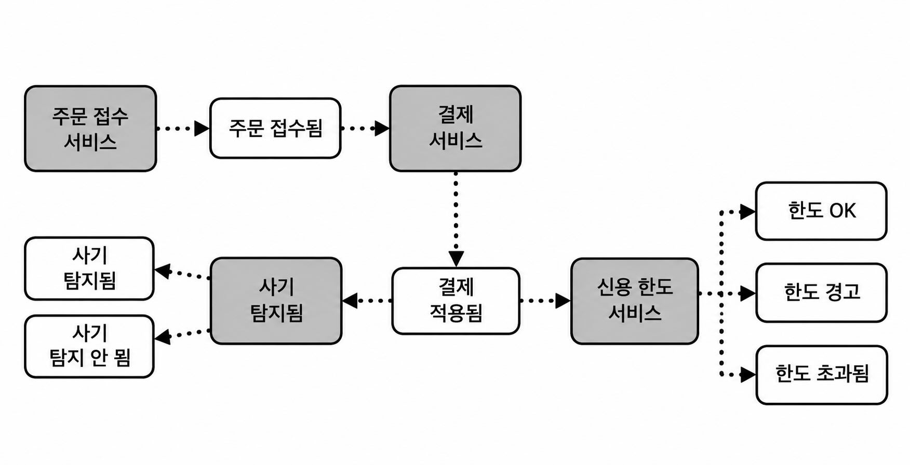
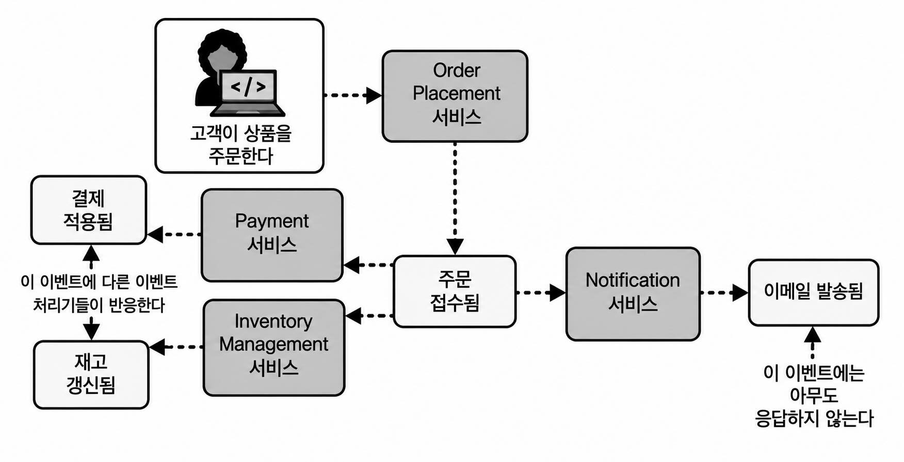
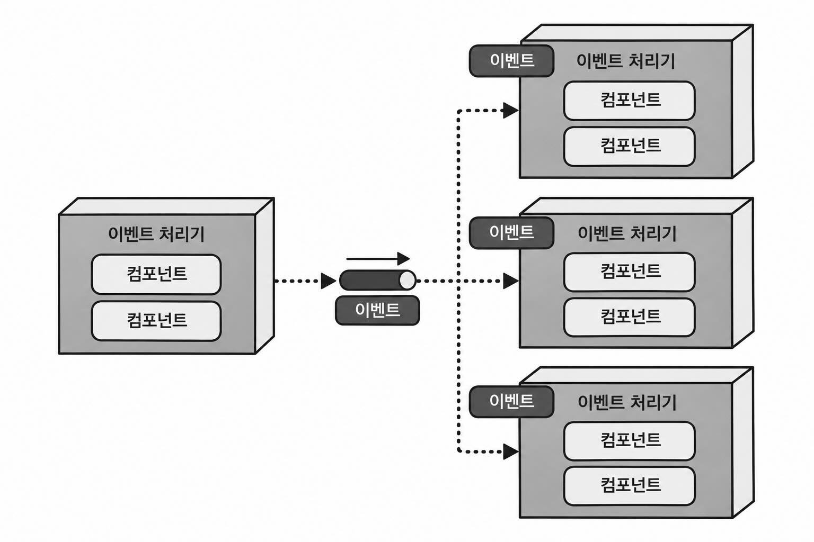
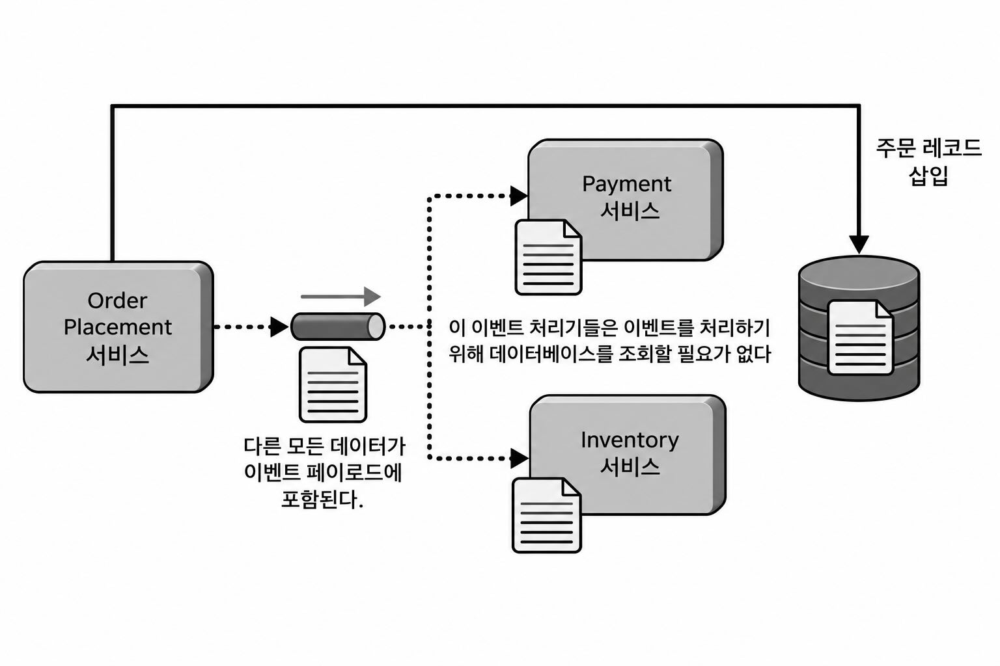
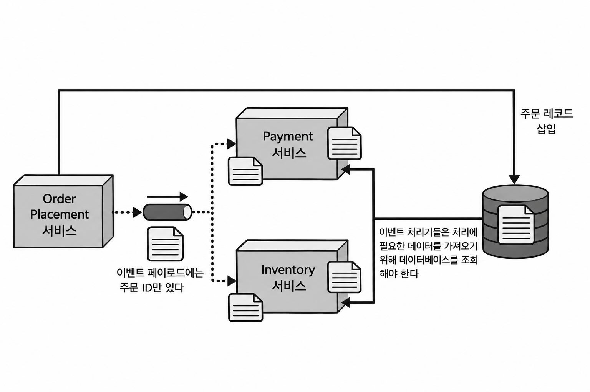

## 15. 이벤트 주도 아키텍처 스타일

- 이벤트 주도 아키텍처(EDA)는 분산 비동기 아키텍처 스타일이다.
- 높은 확장성과 성능이 필요한 시스템에 많이 사용된다.
- 소규모부터 대규모 복합 시스템까지 폭넓게 적용할 수 있다.
- 서로 결합이 느슨한 이벤트 처리 컴포넌트들이 비동기적으로 이벤트를 발생시키고 이에 반응한다.
- EDA 자체를 하나의 아키텍처 스타일로 사용할 수도 있고, 마이크로서비스 같은 다른 스타일에 일부 적용할 수도 있다.

### 요청 기반 모델과 이벤트 기반 모델

#### 요청 기반 모델

- 요청이 요청 오케스트레이터로 들어온다.
- 오케스트레이터가 여러 요청 처리기에게 작업을 전달하고 전체 흐름을 조율한다.
- 요청 처리는 비교적 동기적이고 결정론적이다.
- 특정 요청에 대해 누가 무엇을 처리할지가 정해져 있는 구조이다.

`요청 -> 오케스트레이터 -> 요청 처리기 -> 결과`

#### 이벤트 기반 모델

- 시스템은 특정 이벤트가 발생했다는 사실에 반응해서 동작한다.
- 이벤트를 발생시킨 쪽은 이후 어떤 컴포넌트가 어떻게 처리하는지 알 필요가 없다.

### 15.1 토폴로지

이벤트 주도 아키텍처는 기본적으로 비동기 발사 후 망각(fire-and-forget) 통신을 사용한다.

- 이벤트를 발생시킨 컴포넌트는 이벤트를 전달한 뒤 결과를 기다리지 않는다.
- 다른 이벤트 처리기들이 해당 이벤트에 반응하여 각자의 작업을 수행한다.

주요 구성요소는 다음 네 가지다.

- 개시 이벤트(initiating event)
    - 전체 이벤트 흐름을 시작하는 이벤트
- 이벤트 브로커(event broker)
    - 이벤트를 전달하는 중간 역할
- 이벤트 처리기(event processor)
    - 이벤트를 받아 실제 비즈니스 처리를 수행
- 파생 이벤트(derived event)
    - 이벤트 처리 결과로 새롭게 발생하는 이벤트

#### 기본 이벤트 흐름

일반적인 흐름은 다음과 같다.

`개시 이벤트 → 이벤트 브로커 → 이벤트 처리기 → 파생 이벤트 → 다른 이벤트 처리기 → ...`

1. 개시 이벤트가 발생한다.
2. 이벤트 브로커를 통해 해당 이벤트에 관심 있는 이벤트 처리기로 전달된다.
3. 이벤트 처리기가 자신의 작업을 수행한다.
4. 작업이 끝나면 필요한 경우 파생 이벤트를 발생시킨다.
5. 다른 이벤트 처리기가 그 이벤트에 반응해 자신의 작업을 수행한다.
6. 더 이상 처리할 이벤트가 없으면 흐름이 끝난다.

이 과정에서 각 이벤트 처리기는 자신이 처리할 이벤트만 알고 있으면 된다.

#### 이벤트 브로커와 연합

- 이벤트 브로커는 하나의 중앙 브로커만 존재하는 것이 아니라 여러 브로커가 연합(federation) 된 형태로 구성될 수도 있다.
- 일반적으로 도메인별 브로커들이 군집을 이루고 각각 자신의 이벤트 흐름(event flow)을 관리한다.
- 이벤트 흐름은 해당 작업 흐름에서 사용되는 여러 이벤트 채널(event channel)로 구성된다.
- 브로커는 비동기 통신을 위해 주로
    - 토픽/토픽 교환, Publish-Subscribe, 메시지 스트림 등을 사용한다.

#### 주문 처리 예시

주문 접수 이벤트가 발생하면 각 이벤트 처리기가 자신이 관심 있는 이벤트에 독립적으로 반응하고, 필요한 경우 다음 파생 이벤트를 발생시키며 전체 흐름이 이어진다.

#### 독성 이벤트

이벤트 처리 결과로 발생한 파생 이벤트가 다시 이전 처리기를 자극하고, 그 처리 결과가 또 원래 이벤트를 발생시키는 식으로 이벤트가 무한 반복되는 상황이 발생할 수 있다.

이를 독성 이벤트(poison event)라고 한다.

#### 이벤트 처리기의 독립성
- 이벤트 처리기들은 서로 느슨하게 결합되어 있으며 독립적이다.
- 하나의 이벤트 처리기가 작업을 끝내고 파생 이벤트를 발생시키면 그 처리기의 책임은 끝난다.
- 이후 작업은 해당 이벤트를 구독하는 다른 이벤트 처리기의 책임이다.

### 15.2.1 이벤트 대 메시지

이벤트와 메시지는 비슷해 보이지만 의미와 사용 방식이 다르다.

- 이벤트
    - 이미 어떤 일이 발생했다는 사실을 알린다.
    - `"주문이 접수되었다"`와 같은 형태다.
    - 일반적으로 응답을 요구하지 않는다.
    - 여러 이벤트 처리기가 동시에 관심을 가지고 반응할 수 있다.
    - 토픽, 스트림, Publish-Subscribe 등을 이용한 일대다 통신에 가깝다.
- 메시지
    - 어떤 작업을 수행하라는 명령이나 정보를 요청하는 쿼리에 가깝다.
    - `"결제를 처리해라"`, `"배송 정보를 알려달라"`와 같은 형태다.
    - 일반적으로 특정 처리기의 응답을 기대한다.
    - 대기열이나 메시징 서비스를 통해 하나의 처리기로 전달되는 일대일 통신에 가깝다.

이벤트 주도 아키텍처라고 해서 이벤트만 사용하는 것은 아니며, 특정 처리기에 요청해야 하는 경우에는 메시지를 사용할 수도 있다.

### 15.2.2 파생 이벤트

- 이벤트 처리기는 이벤트를 받아 작업을 수행한 뒤 파생 이벤트(derived event) 를 발생시킬 수 있다.
- 하나의 입력 이벤트에서 여러 개의 파생 이벤트가 발생할 수도 있다.

예를 들어 결제가 적용되면 동시에

- 사기 탐지
- 신용 한도 확인

등의 처리를 수행할 수 있다.

각 처리 결과에 따라 다시 다른 파생 이벤트가 만들어진다.

- 한도 OK
    - 카드 잔액 등의 정보를 이벤트 페이로드에 포함해 다운스트림 처리기가 활용할 수 있다.
- 한도 경고
    - Notification 처리기가 고객에게 경고를 전달할 수 있다.
- 한도 초과됨
    - 구매 거부나 신용 한도 조정 같은 별도의 처리기가 반응할 수 있다.

파생 이벤트가 지나치게 많아지면 이후 설명하는 하루살이 떼 안티패턴으로 이어질 수 있으므로 주의해야 한다.

### 15.2.3 확장 능력을 고려한 이벤트 발생

- 현재는 아무 처리기도 관심을 가지지 않는 파생 이벤트라도 의도적으로 발생시켜 둘 수 있다.
- 이런 이벤트를 확장 가능 파생 이벤트(extensible derived event) 라고 한다.
- 당장은 사용하지 않더라도 미래에 새로운 기능을 쉽게 연결할 수 있는 확장 지점(hook) 역할을 한다.

예를 들어 Notification 처리기가 이메일을 보낸 뒤
- 이메일 전송됨 이벤트를 발생
- 현재 이 이벤트를 처리하는 컴포넌트가 없어도 문제가 없다. 나중에 이메일 분석 기능이 필요해지면
- 이메일 전송됨 -> Email Analyzer 처럼 새로운 이벤트 처리기만 추가하면 된다.

기존 Notification 처리기나 다른 이벤트 처리기를 수정할 필요가 없으므로 아키텍처의 확장성이 좋아진다.

### 15.2.4 비동기 역량들

- 이벤트 주도 아키텍처는 발사 후 망각뿐 아니라 요청/응답 처리에서도 비동기 통신을 많이 사용한다.
- 비동기 통신은 사용자 관점의 반응성을 크게 높일 수 있다.

#### 동기 vs 비동기

리뷰 등록 예시

- 동기 방식
    - 네트워크 왕복 + 실제 리뷰 처리까지 기다린다.
    - 약 `3,100ms`
    - 대신 응답을 받은 시점에는 리뷰가 실제로 처리되었다는 보장이 있다.
- 비동기 방식
    - 이벤트를 전달한 뒤 바로 사용자에게 응답한다.
    - 약 `25ms`
    - 실제 리뷰 처리는 뒤에서 계속 진행된다.
    - 따라서 빠르게 응답할 수 있지만, 그 시점에 실제 처리가 완료되었다는 보장은 없다.

#### 반응성과 성능
- 반응성
    - 사용자가 요청한 뒤 얼마나 빨리 응답을 받는가
- 성능
    - 실제 작업 자체를 얼마나 빠르게 처리하는가

예를 들어 리뷰 처리에는 여전히 3초가 걸리더라도 사용자에게 25ms 만에 응답하면 반응성은 좋아진다.

반대로 리뷰 처리 자체를 병렬화하거나 최적화해서 3초 -> 1초로 줄이는 것은 성능을 개선한 것이다.

#### 동적 퀀텀 얽힘

두 시스템이 동기 호출로 강하게 연결되어 있으면 하나의 시스템처럼 묶이게 된다.

- 뒤쪽 시스템이 느려지거나 장애가 나면 앞쪽 시스템도 영향을 받는다.
- 확장할 때도 두 시스템의 의존성을 함께 고려해야 한다.

비동기 통신으로 바꾸면
- 각 시스템을 독립적인 아키텍처 퀀텀으로 유지할 수 있다.
- 상대 시스템이 일시적으로 장애가 나더라도 요청이나 이벤트를 보관했다가 나중에 처리할 수 있다.
- 각 시스템을 독립적으로 확장할 수도 있다.

비동기 통신은 시스템 간 동적 결합을 줄여 독립성을 높인다.

### 15.2.5 브로드캐스팅 능력

- 이벤트를 브로드캐스팅할 때 생산자는
    - 누가 이벤트를 받을지
    - 받은 뒤 무엇을 할지 알 필요가 없다.
- 이처럼 이벤트 처리기들이 서로의 동작을 모르는 것을 의미적 분리(semantic decoupling)라고 한다.
- 브로드캐스팅은 최종 일관성이나 복합 이벤트 처리(CEP) 등에 활용된다.

### 15.2.6 이벤트 페이로드
이벤트 페이로드는 이벤트에 포함되어 전달되는 정보이며 크게 두 가지 방식이 있다.

- 데이터 기반 이벤트 페이로드
- 키 기반 이벤트 페이로드

#### 데이터 기반 이벤트 페이로드

- 처리에 필요한 데이터를 이벤트에 모두 포함해서 전달한다.
- 이벤트 처리기가 별도로 DB를 조회할 필요가 없다.

장점
- DB 조회가 줄어 성능, 반응성, 확장성이 좋다.
- 다른 서비스의 DB에 접근할 수 없거나 경계 컨텍스트가 엄격한 환경에서 유용하다.
- 각 처리기는 이벤트만 받아 필요한 데이터를 꺼내 쓰면 된다.

단점
- 같은 데이터가 DB와 여러 이벤트에 복사되어 존재하므로 데이터 일관성/무결성 유지가 어렵다.
    - DB에서 주문 정보를 수정해도 이미 발행된 이벤트에는 예전 값이 남아 있을 수 있다.
    - 비동기 처리이므로 경우에 따라 새 값이 담긴 이벤트가 이전 값보다 먼저 처리될 수도 있다.
- 페이로드에 많은 데이터가 들어가므로 계약 관리가 복잡하다.
    - 엄격한 계약을 쓸지 느슨한 계약을 쓸지 결정해야 한다.
    - 계약 변경으로 이벤트 처리기 사이에 정적 결합이 생길 수 있다.
- 버전 관리도 필요하다.
    - 버전을 사용하면 하위 호환성과 민첩성을 높일 수 있다.
    - 대신 모든 처리기가 동일한 버전 관리 규칙을 따라야 한다.
    - 버전 협상이나 사용 중지 전략도 복잡해진다.
- 스탬프 결합(stamp coupling) 문제가 생길 수 있다.
    - 공통 자료구조 전체를 전달하지만 각 처리기는 그중 일부만 사용한다.
    - 사용하지 않는 필드가 변경되어도 처리기에 영향을 줄 수 있다.
- 필요한 정보보다 훨씬 많은 데이터를 전송하므로 대역폭 낭비가 생길 수 있다.
- EDA에서는 이벤트 소비자가 누군지 생산자가 알지 못하므로 소비자 주도 계약을 적용하기 어렵다.

#### 키 기반 이벤트 페이로드

- 이벤트에는 `order_id` 같은 식별 키만 포함한다.
- 실제 처리에 필요한 데이터는 이벤트 처리기가 DB에서 조회한다.

단점
- 이벤트마다 DB를 조회해야 하므로 성능, 반응성, 확장성이 떨어질 수 있다.
- DB 부하가 증가한다.
- 다른 서비스의 데이터에 접근할 수 없는 경우 문제가 될 수 있다.

장점
- 실제 데이터는 DB 한 곳에 있으므로 단일 기록 시스템을 유지하기 쉽다.
    - 데이터 일관성과 무결성이 좋아진다.
    - 처리 시점에 DB에서 최신 데이터를 조회할 수 있다.
- 이벤트 계약이 작고 단순하다.
    - 계약 변경, 버전 관리, 버전 협상, 사용 중지 전략 등의 문제가 크게 줄어든다.
- 스탬프 결합 문제가 거의 없다.
- 이벤트 크기가 작아 대역폭 사용량도 적다.

#### 트레이드오프

| 기준 | 데이터 기반 페이로드 | 키 기반 페이로드 |
|---|---|---|
| 성능과 확장성 | 좋음 | 나쁨 |
| 계약 관리 | 나쁨 | 좋음 |
| 스탬프 결합 | 나쁨 | 좋음 |
| 대역폭 사용률 | 나쁨 | 좋음 |
| 제한된 DB 접근 환경 | 좋음 | 나쁨 |
| 전반적인 시스템 취약성 | 나쁨 | 좋음 |

- 데이터를 다 싣는다 -> 빠르고 독립적이지만 계약, 동기화가 복잡
- ID만 싣는다 -> 단순하고 일관성이 좋지만 DB 조회 비용이 발생

모든 이벤트를 한 방식으로 통일할 필요는 없고, 이벤트 종류마다 적절한 페이로드 방식을 선택하면 된다.

### 빈혈성 이벤트

- 이벤트 처리에 필요한 맥락 정보가 부족한 이벤트를 빈혈성 이벤트(anemic event)라고 한다.
- 예를 들어 `고객 프로필 갱신됨` 이벤트에 고객 ID만 있다면 각 서비스가 판단하기 어렵다.
    - 서비스 1: 어떤 데이터가 변경됐지?
    - 서비스 2: 이 변경을 내가 처리해야 하나?
    - 서비스 3: 변경 전 값은 뭐였지?
- 필요한 정보를 이벤트에도 없고 DB에서도 알 수 없다면 이벤트를 제대로 처리하지 못한다.

### 이벤트 페이로드 세분도
- 키 기반
    - ID만 전달한다.
    - 생성/삭제에는 잘 맞지만, 업데이트에서는 정보가 부족할 수 있다.
- 데이터 기반
    - 처리에 필요한 데이터를 함께 전달한다.
    - DB 조회는 줄지만, 너무 많이 넣으면 스탬프 결합과 대역폭 문제가 생긴다.

고객 프로필 갱신의 예는 키 적절한 수준의 정보를 제공해서 빈혈성 파생 이벤트 문제를 피함
- 키, 데이터 두 극단 사이 어딘가에 위치함