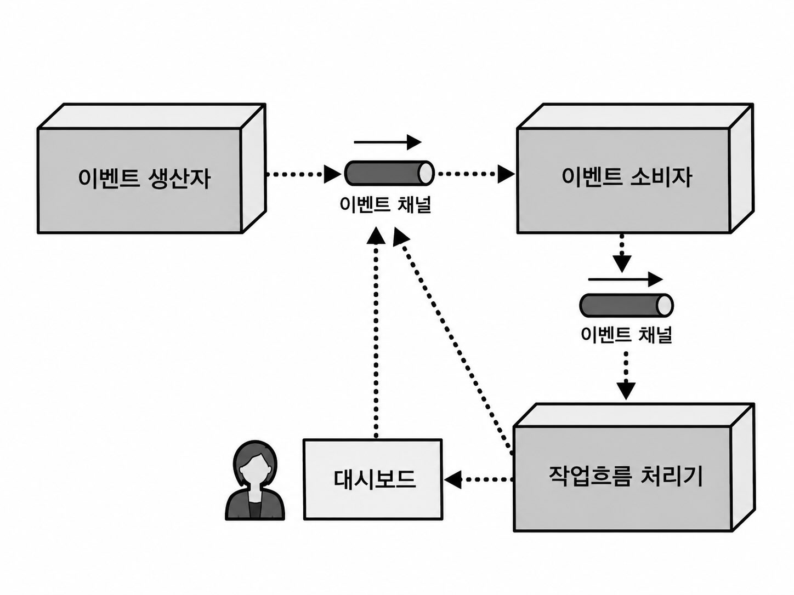
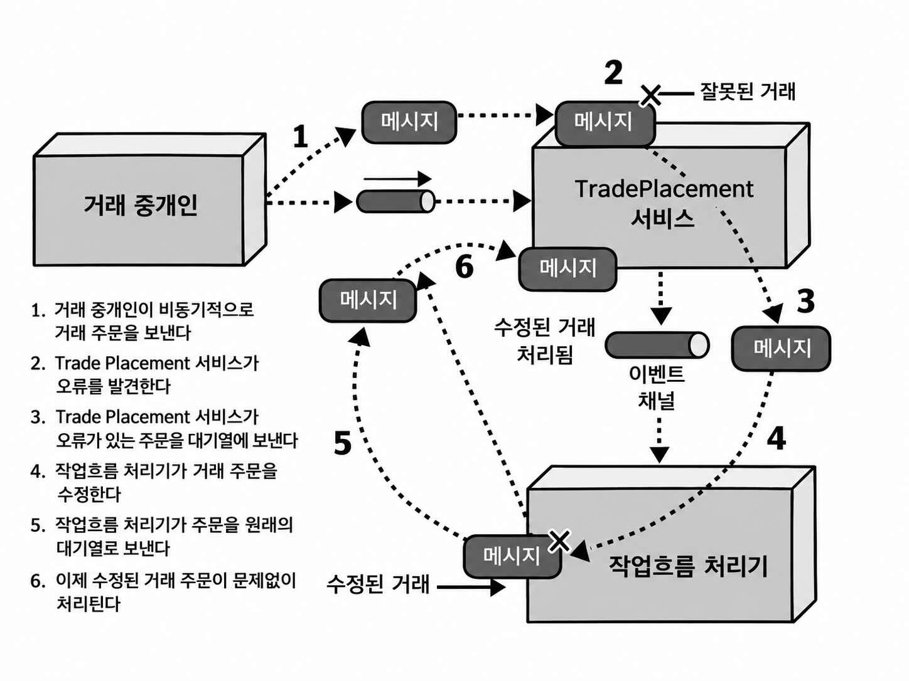
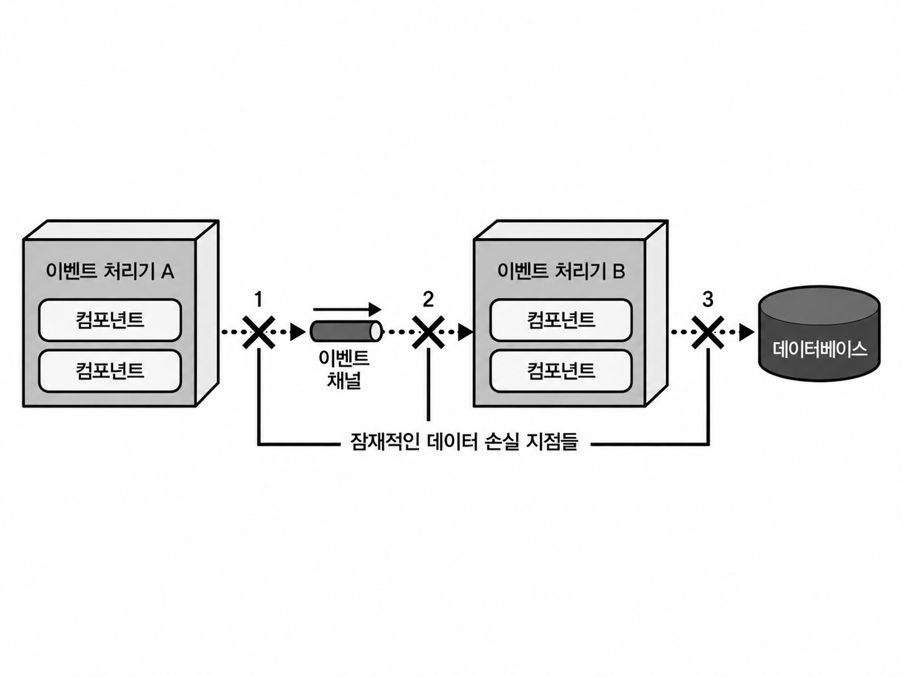
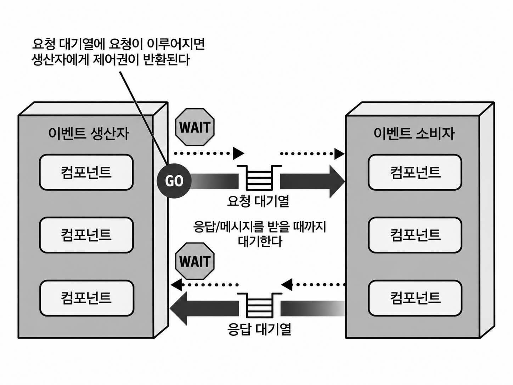
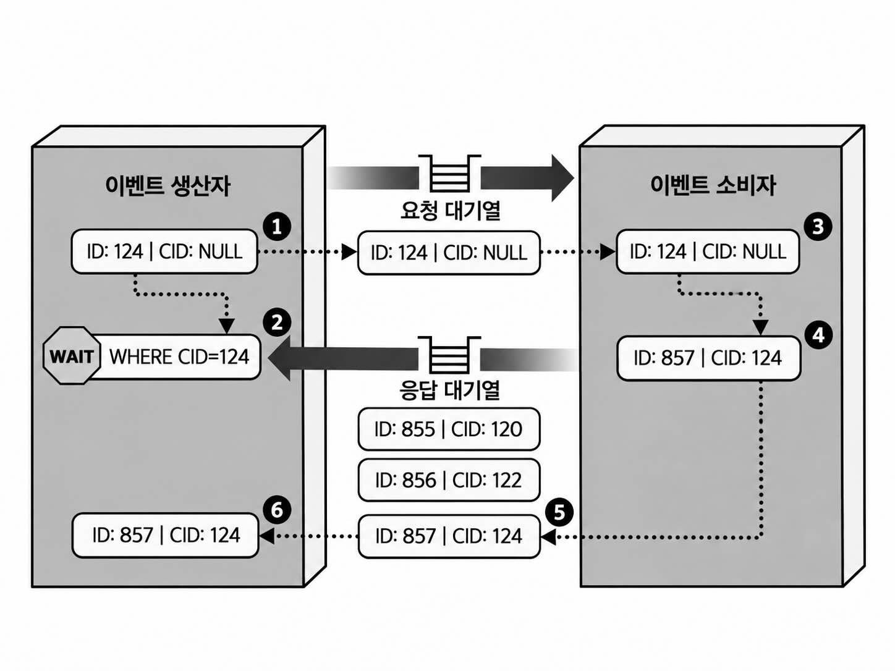
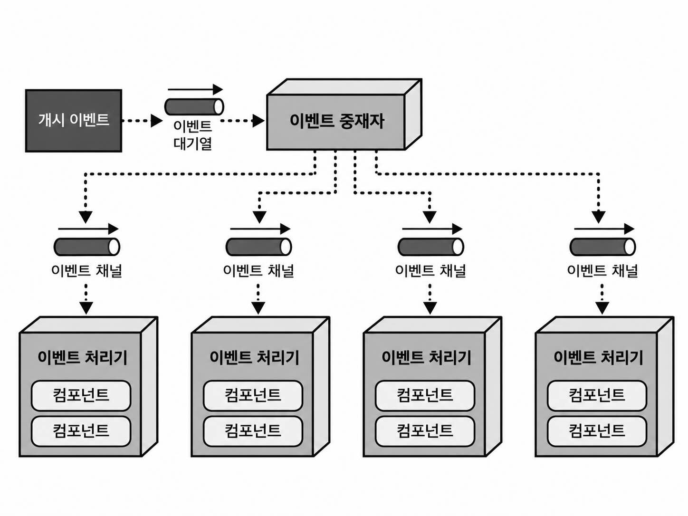
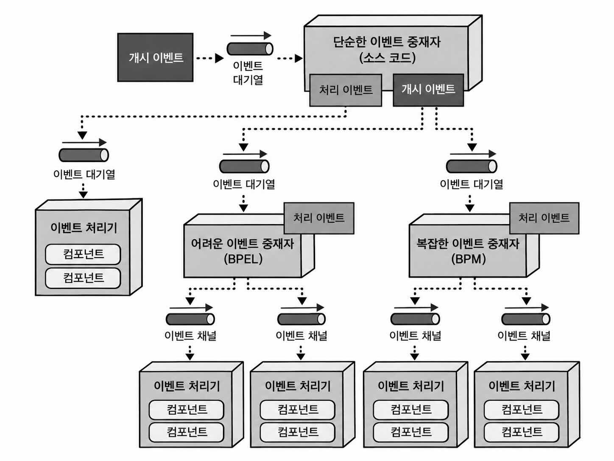

## 15. 이벤트 주도 아키텍처 스타일

### 15.2.7 하루살이 떼 안티패턴

- 이벤트의 세분도가 너무 낮거나 의미가 불분명하면 이벤트 처리기가 불필요한 판단을 해야 한다.

예를 들어 `사기 검사됨`만 발생시키면 각 이벤트 처리기가 페이로드를 다시 분석해서
- 사기가 탐지됐는지
- 탐지되지 않았는지를 판단해야 한다.

이를
- `사기 탐지됨`
- `사기 탐지되지 않음` 처럼 결과별 이벤트로 나누면 처리기는 페이로드를 분석하지 않고 이벤트 종류만 보고 반응 여부를 결정할 수 있다.

하지만 반대로 이벤트를 지나치게 잘게 나누면 하루살이 떼(Swarm of Gnats) 안티패턴에 빠질 수 있다.

예시) 프로필 변경 시 청구지 갱신됨, 배송지 갱신됨, 전화번호 갱신됨
- 작은 이벤트가 너무 많이 발생하면 전체 이벤트 흐름을 파악하기 어려워진다.

이런 경우에는 여러 변경을 프로필 갱신됨 같은 하나의 의미 있는 이벤트로 묶을 수 있다.

#### 처리나 상태 변경의 결과에 초점을 맞춰라

이벤트를 변경된 필드 하나하나 기준으로 만들지 말고, 비즈니스 관점에서 무슨 결과가 발생했는가를 기준으로 만들라는 뜻이다.

예시) `전화번호 변경됨 + 주소 변경됨 + 배송지 변경됨` -> `프로필 갱신됨`

### 15.2.8 오류 처리

비동기 처리에서 오류가 발생했다고 전체 흐름을 멈춰버리면 반응성이 크게 떨어진다.

이를 피하기 위해 작업흐름 이벤트(Workflow Event) 패턴을 사용할 수 있다.

#### 기본 흐름

1. 이벤트 소비자가 메시지를 처리한다.
2. 오류가 발생하면 오류 처리를 직접 붙잡고 있지 않고 작업흐름 처리기에 위임한다.
3. 원래 이벤트 소비자는 다음 메시지를 계속 처리한다.
4. 작업흐름 처리기가 오류를 분석하고 수정한다.
5. 수정된 메시지를 다시 원래 이벤트 흐름에 넣어 재처리한다.

자동으로 수정할 수 없는 오류라면

`오류 메시지 -> 별도 대기열 -> 담당자 확인/수정 -> 다시 원래 채널`

처럼 사람이 개입할 수도 있다.

즉, 오류 하나 때문에 정상 이벤트 흐름 전체를 막지 않는 것이 핵심이다.

#### 주식 주문 예시

거래 주문이 다음 순서로 들어왔다고 하자.

`거래1 → 거래2 → 거래3 → 거래4 ...`

`거래2`에 잘못된 데이터가 있어 오류가 발생하면

- `거래2`는 작업흐름 처리기로 보내 수정한다.
- 하지만 주식 주문처럼 처리 순서가 중요한 경우, 같은 계좌의 `거래3`, `거래4`를 먼저 처리하면 안 된다.
- 따라서 오류가 발생한 거래와 같은 계좌의 후속 주문은 임시 대기열에 FIFO 순서로 보관한다.
- `거래2`가 수정되어 정상 처리되면 임시 대기열의 거래들을 다시 순서대로 꺼내 처리한다.

### 15.2.9 데이터 손실 방지

- 비동기 통신에서는 이벤트나 메시지가 중간에 사라지거나 최종 목적지에 도달하지 못하는 **데이터 손실**을 신경 써야 한다.

#### 이벤트 채널

- AMQP(Advanced Message Queuing Protocol) 기반 브로커에서는 이벤트가 익스체인지(exchange)로 발행되고, 바인딩 규칙에 따라 각 이벤트 처리기의 대기열로 전달된다.
    - RabbitMQ, Amazon SNS, Azure Event Hubs 등의 방식이 여기에 해당한다.
- Jakarta Messaging(구 JMS)은 Topic과 지속적 구독자를 사용할 수 있다.
    - 구독자가 내려가 있어도 이벤트를 저장했다가 다시 사용 가능해지면 전달할 수 있다.
- Kafka 같은 이벤트 스트리밍 방식도 사용할 수 있다.

#### 데이터 손실이 발생할 수 있는 지점

크게 세 곳에서 손실될 수 있다.

1. **A가 이벤트를 보냈지만 브로커에 안전하게 저장되기 전에 장애 발생**
    - 이벤트가 대기열에 도달하지 못하거나 브로커가 이벤트를 읽기 전에 다운
    - 영속적 메시지 대기열을 사용한다.
        - 이벤트 브로커가 다운되어도 재시동 했을 때 이벤트 처리를 재개할 수 있음
    - 브로커가 이벤트를 영속화하고 승인할 때까지 생산자가 기다린다.
2. **B가 이벤트를 읽었지만 처리하기 전에 장애 발생**
    - 자동 승인 대신 클라이언트 승인 모드를 사용할 수 있다.
    - 이벤트를 읽었다고 바로 대기열에서 제거하지 않고, 처리가 완료된 뒤 승인하면 제거한다.
    - 이벤트에 클라이언트 ID를 붙여서, 다른 소비자가 이벤트를 읽거나 처리할 수 없게 한다.
3. **B가 이벤트를 처리했지만 DB 저장에 실패**
    - 데이터베이스 ACID 트랜잭션과 LPS(last participant supprot; 최종 참여자 지원)를 이용한다.
    - DB 저장까지 성공한 뒤 메시지 처리를 승인하고 영속 대기열에서 이벤트를 제거한다.

즉,

`브로커까지 안전하게 저장 -> 소비자가 정상 처리 -> DB 저장까지 성공`

해야 이벤트를 완전히 처리된 것으로 본다.

### 15.2.10 요청-응답 처리

- EDA에서도 다른 이벤트 처리기의 즉각적인 응답이 필요한 경우가 있다.
- 이 경우 비동기 메시징으로 요청-응답을 구현하며, 책에서는 이를 의사동기 통신이라고 한다.

#### 기본 흐름

- 생산자가 요청 대기열에 메시지를 보내면 제어권은 반환된다.
- 소비자는 요청을 처리한 뒤 응답 대기열에 응답을 보낸다.
- 생산자는 응답 대기열에서 자신의 응답을 기다린다.

#### CID 방식

- 하나의 응답 대기열을 여러 요청이 함께 사용하면 어떤 응답이 어떤 요청의 것인지 구분해야 한다.
- 이를 위해 상관관계 ID(Correlation ID, CID) 를 사용한다.

예시) 

`요청: ID=124`

응답:

`ID=857, CID=124`

생산자는 `CID=124`인 응답을 찾아 원래 요청과 연결한다.

#### 임시 응답 대기열

- 요청마다 별도의 임시 응답 대기열을 만드는 방법도 있다.
- 생산자가 요청에 `reply-to`로 임시 대기열을 지정하면 소비자는 그곳으로 응답한다.
- 장점
    - CID로 응답을 구분할 필요가 없어 단순하다.
- 단점
    - 요청마다 대기열을 생성하고 삭제해야 한다.
    - 메시지가 많으면 브로커의 부담이 커지고 성능과 반응성이 나빠질 수 있다.

따라서 요청이 많은 시스템에서는 CID 방식이 더 적합하다.

### 15.2.11 중재된 이벤트 주도 아키텍처

#### 코레오그래피형 vs 오케스트레이션형 EDA
- 지금까지 본 EDA는 코레오그래피형
    - 이벤트 처리기들이 이벤트를 발행하고 다른 처리기들이 각자 반응한다.
    - 전체 흐름을 통제하는 중앙 컴포넌트가 없다.
- 이벤트 흐름을 더 엄격하게 제어해야 한다면 오케스트레이션형 EDA를 사용할 수 있다.
    - 이를 중재자 토폴로지(mediator topology) 라고 한다.
    - 중심에 이벤트 중재자(event mediator) 가 존재한다.

#### 이벤트 중재자
- 개시 이벤트를 받아 전체 작업 흐름과 처리 순서를 관리한다.
- 중재자는 각 처리기의 구체적인 내부 처리 방법까지는 모르지만,
    - 어떤 단계가 필요한지
    - 어떤 순서로 실행해야 하는지
    - 어떤 작업을 병렬로 실행할 수 있는지를 알고 있다.
- 일반적으로 이벤트보다 메시지를 사용해 특정 처리기에게 작업을 지시한다.
- 처리기는 작업을 수행하고 중재자에게 결과를 돌려준다.
- 코레오그래피형처럼 처리기가 임의로 파생 이벤트를 브로드캐스트하며 흐름을 이어가지 않는다.

즉,
- 코레오그래피형: 각 처리기가 알아서 반응
- 중재자형: 중재자가 전체 흐름을 알고 지휘

#### 여러 중재자

- 하나의 거대한 중재자보다는 여러 중재자를 둘 수 있다.
- 보통 특정 도메인이나 이벤트 그룹별로 나눈다.
- 이를 통해
    - 중재자가 단일 장애점(SPOF)이 되는 것을 줄이고
    - 처리량과 성능도 향상시킬 수 있다.

#### 중재자 구현

작업 흐름의 복잡도에 따라 적절한 중재자를 선택한다.

- 단순한 흐름
    - Apache Camel, Mule ESB, Spring Integration 등
    - 코드로 직접 작업 흐름을 정의할 수 있다.
- 복잡한 조건/오류 처리
    - BPEL 기반 중재자
    - Apache ODE, Oracle BPEL Process Manager 등
    - BPEL은 복잡하기 때문에 보통 GUI 도구를 이용한다.
- 사람의 개입이 필요한 장기 작업
    - BPM 엔진이 적합하다.
    - 예: 거래 승인을 사람이 직접 확인해야 하는 경우

따라서 무조건 강력한 BPM을 쓰기보다 작업 흐름의 복잡도에 맞는 중재자를 선택해야 한다.

#### 중재자 위임

단순 중재자가 모든 작업을 직접 처리할 필요는 없다.

- 단순한 작업 -> 직접 처리
- 어려운 작업 -> BPEL 중재자에 위임
- 복잡하거나 사람의 개입이 필요한 작업 -> BPM 중재자에 위임
- BPEL, BPM에 전달된 이벤트들의 처리를 단순한 이벤트 중재자가 알아야 할 수 있고(클라이언트에게 결과를 알리기 위해) 또는 해당 작업흐름 전체를 다룬 장재자에게 위임하고 잊어버리게 할 수 있다.

이를 통해 하나의 중재자에 모든 복잡성을 몰아넣지 않을 수 있다.

### 주문 처리 예시

주문 처리 흐름을 단계로 나누면 다음과 같다.

1. 주문 접수
2. 주문 처리
3. 주문 이행
4. 주문 배송
5. 고객 알림

중재자는 단계 간 순서는 관리하지만, 같은 단계 안의 작업은 병렬로 실행할 수 있다.

예를 들어 주문 처리 단계에서는

- 고객에게 주문 접수 이메일 전송
- 결제 적용
- 재고 수량 조정

을 동시에 실행할 수 있다.

이 작업들이 모두 성공하면 다음 단계인 주문 이행으로 넘어간다.

즉,

`단계 1 완료 -> 단계 2의 여러 작업 병렬 실행 -> 모두 완료 -> 단계 3 → ...`

처럼 진행된다.

코레오그래피형과 달리 중재자가 작업흐름의 상태와 제어권을 가진다.
- 중재자는 이벤트 상태 유지, 오류 처리, 복구, 재시작 을 관리할 수 있다.
- 예를 들어 결제 실패 시 다음 단계로 진행하지 않고 상태를 저장한 뒤, 결제가 해결되면 중단된 지점부터 다시 시작할 수 있다.
- 단점
    - 복잡하고 동적인 이벤트 흐름을 미리 모델링하기 어렵다.
    - 이런 경우 일반 흐름은 중재자가 관리하고, 재고 부족이나 비전형적인 오류처럼 동적이고 복잡한 경우에는
    중재자와 코레오그래피를 결합한 하이브리드 방식을 사용할 수 있다.
    - 중재자 자체가 병목이 될 수 있고, 이벤트 처리기 간 분리 수준도 코레오그래피형보다 낮다.
    - 따라서 성능과 확장성은 코레오그래피형보다 떨어질 수 있다.

중재자형은 흐름 제어와 오류 복구에 강하고, 코레오그래피형은 성능과 확장성에 더 유리하다.