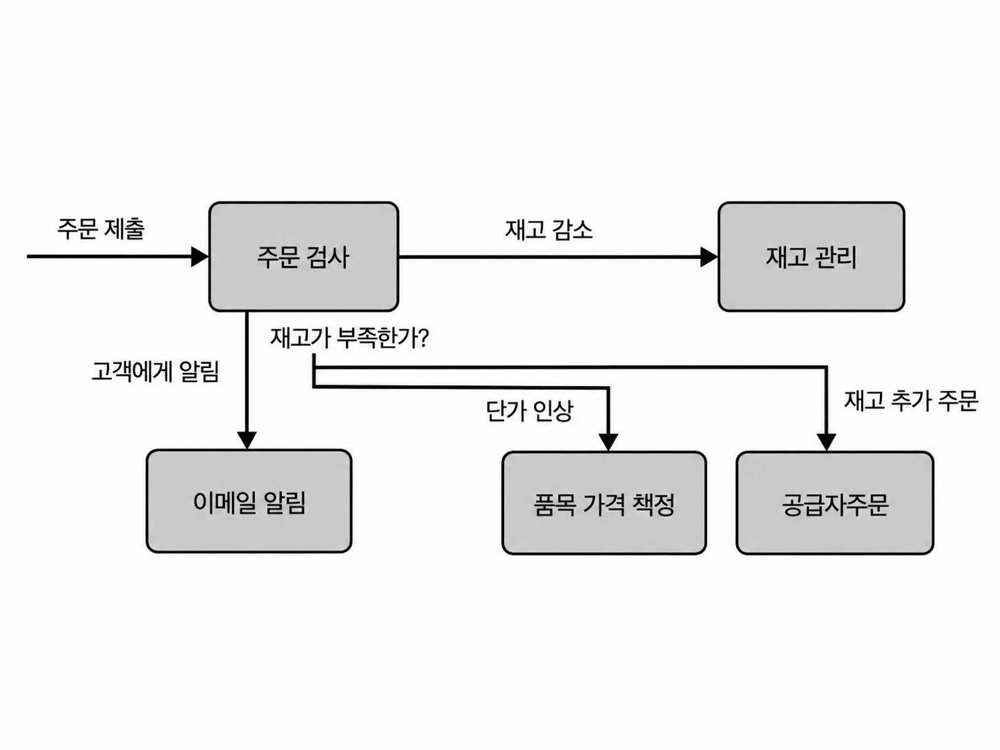
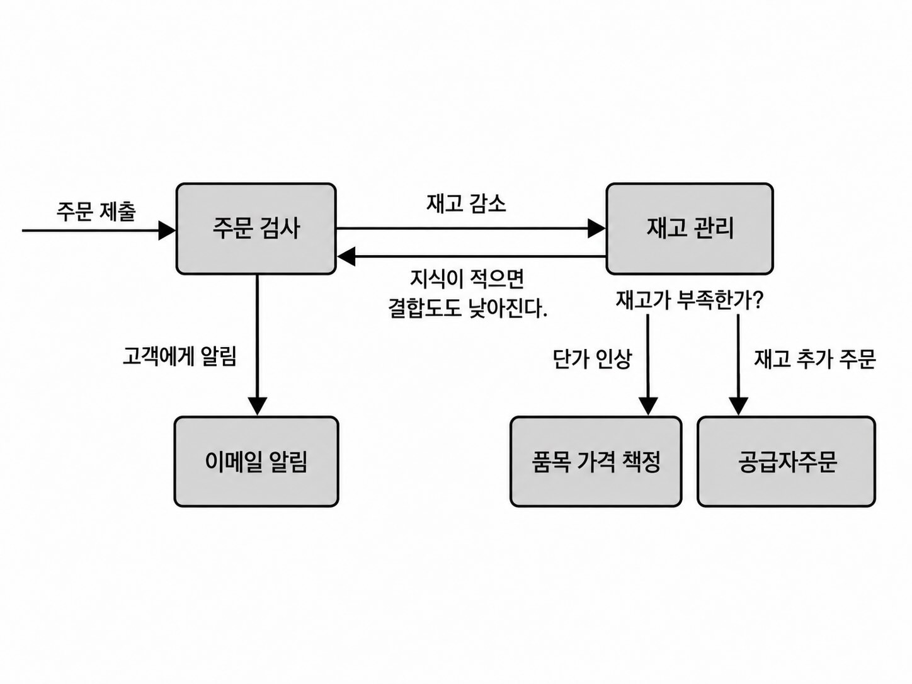
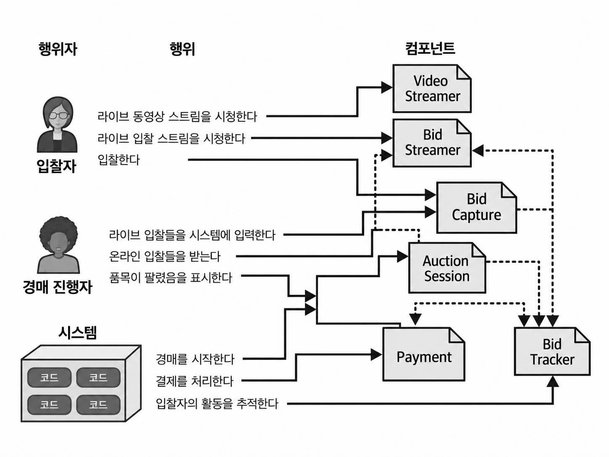
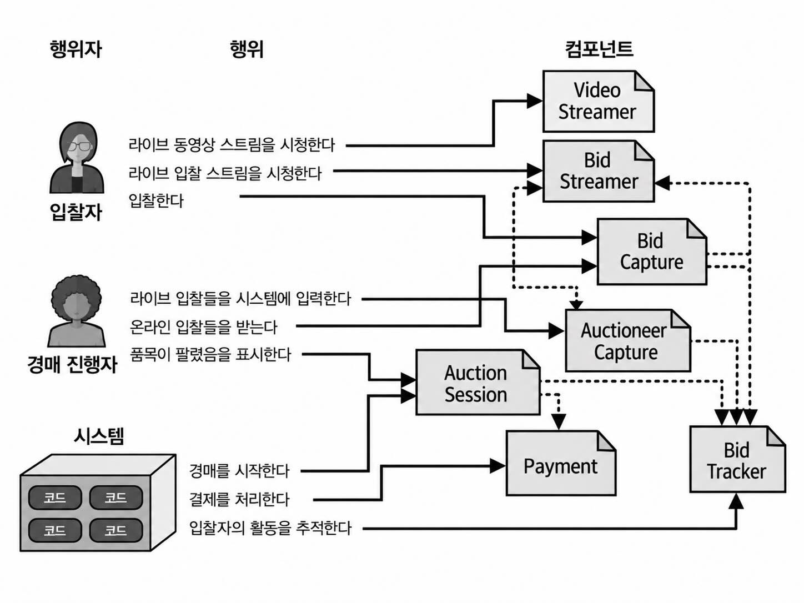

## 컴포넌트 기반 사고

### 8.4 컴포넌트 결합

컴포넌트 결합
- 컴포넌트끼리 통신하거나, 한 컴포넌트의 변경이 다른 컴포넌트에 영향을 주면 서로 결합되어 있다.
- 결합도가 높을수록 유지보수와 테스트가 어려워질 수 있다.

#### 8.4.1 정적 결합
- 구심 결합(fan-in, CA)
    - 다른 컴포넌트들이 해당 컴포넌트에 의존하는 정도
    - 들어오는 의존성의 수
    - 예시) 주문 접수, 주문 배송 컴포넌트가 고객 알림 컴포넌트에 의존
- 원심 결합(fan-out, CE)
    - 해당 컴포넌트가 다른 컴포넌트에 의존하는 정도
    - 나가는 의존성의 수
    - 예시) 주문 접수 -> 주문 이행일 경우 주문접수가 주문 이행에 의존

#### 8.4.2 시간적 결합
- 특정 작업이 정해진 순서나 시점에 실행되어야 하는 의존성
    - 예시) 주문 접수가 완료되어야 주문 배송을 진행할 수 있음
- 이런 결합은 코드 분석 도구만으로 발견하기 어렵고, 설계 문서나 오류 상황 등을 통해 파악되는 경우가 많다.

#### 8.4.3 데메테르의 법칙
- 컴포넌트나 서비스 간 결합도가 낮을수록 유지보수와 테스트가 쉬워진다.
- 데메테르의 법칙
    - 컴포넌트나 서비스는 다른 컴포넌트나 서비스에 대해 필요한 최소한의 지식만 가져야 한다.

예시)
- 기존 Order Placement는 주문 처리 외에도 여러 사실을 알고 있다.
    - 주문 시 재고를 감소해야 함
    - 재고가 부족하면 추가 주문해야 함
    - 재고 부족 시 품목 가격을 조정해야 함
    - 주문 완료 후 고객에게 이메일을 보내야 함
- 직접 수행할 책임이 없더라도 이런 지식을 많이 가지고 있으면 다른 컴포넌트들과 강하게 결합된다.

데메테르의 법칙 적용
- 재고와 관련된 판단은 Inventory Management가 알도록 책임과 지식을 옮긴다.
    - 재고 부족 여부
    - 추가 재고 주문
    - 가격 조정
- 그러면 Order Placement는 자신이 반드시 알아야 하는 내용만 알고, 다른 컴포넌트에 대한 지식이 줄어 결합도가 낮아진다.

주의
- 결합이 완전히 사라지는 것은 아니다.
- Order Placement에서 제거된 결합이 Inventory Management 쪽으로 옮겨질 수 있다.
- 따라서 데메테르의 법칙을 적용한다고 시스템 전체 결합도가 반드시 감소하는 것은 아니며, 결합이 다른 곳으로 재분배될 수도 있다.

### 8.5 사례 연구: 고잉, 고잉, 곤-컴포넌트의 발견

GGG라는 경매 시스템을 행위자/행동 접근법으로 분석한다.

1. 행위자와 행동을 식별한다.
- 입찰자
    - 라이브 동영상/입찰 스트림을 본다.
    - 입찰한다.
- 경매 진행자
    - 현장 입찰을 입력한다.
    - 온라인 입찰을 확인한다.
    - 품목이 팔렸음을 표시한다.
- 시스템
    - 경매를 시작한다.
    - 결제를 처리한다.
    - 입찰자의 활동을 추적한다.

2. 행동을 기반으로 초기 컴포넌트를 식별한다.
- Video Streamer: 경매 영상을 스트리밍
- Bid Streamer: 입찰 정보를 스트리밍
- Bid Capture: 입찰 정보를 수집
- Auction Session: 경매 세션을 관리
- Payment: 결제 처리
- Bid Tracker: 입찰 정보를 추적/기록

처음부터 완성된 구조를 만드는 것이 아니라, 행위와 책임을 기준으로 초기 컴포넌트 집합을 만든다

3. 아키텍처 특성을 분석해 컴포넌트를 다시 조정한다.
- 초기에는 Bid Capture가 입찰자와 경매 진행자의 입찰을 모두 처리한다.
- 그러나 두 영역이 요구하는 아키텍처 특성은 다를 수 있다.
    - 입찰자는 수백~수천 명이 될 수 있어 확장성/탄력성이 중요하다.
    - 경매 진행자는 한 명이므로 같은 수준의 확장성은 필요하지 않으며, 안정적인 동작이 더 중요할 수 있다.
- 따라서 Bid Capture를
    - Bid Capture
    - Auctioneer Capture로 분리한다.

4. 컴포넌트 간 관계도 함께 조정한다.
- 새 컴포넌트가 생기면 스트리밍, 추적 등의 기존 컴포넌트와의 연결 관계도 다시 구성한다.
- 즉 컴포넌트 식별 -> 책임 분석 -> 아키텍처 특성 분석 -> 재구성 과정을 반복한다.

처음 만든 설계가 최종 설계가 되는 경우는 드물며, 요구사항이 구체화될수록 반복적으로 수정한다.

하나의 절대적인 최적 설계는 없으며, 여러 설계의 트레이드오프를 비교해 가장 적절한, 즉 '가장 덜 나쁜' 설계를 선택한다.