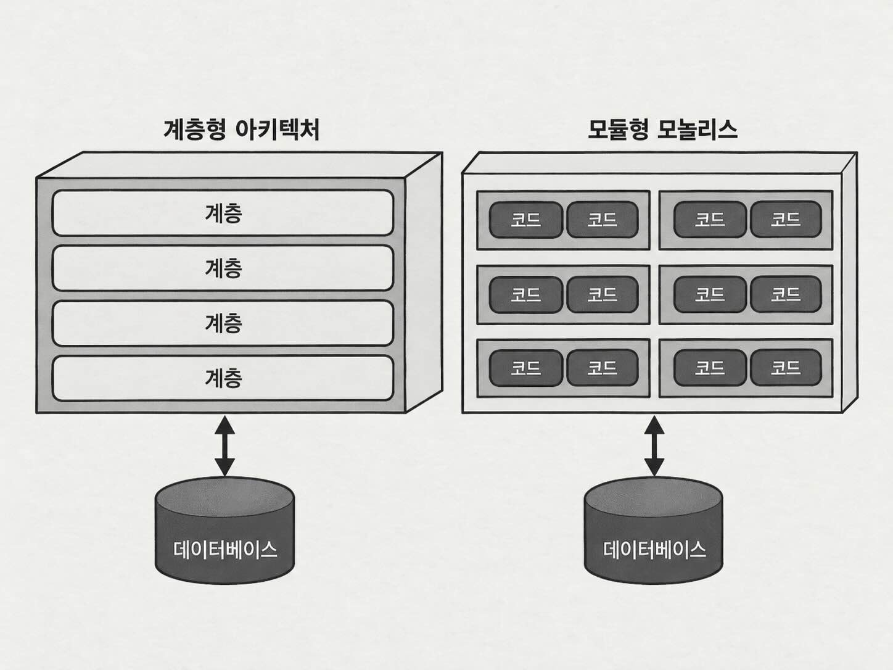
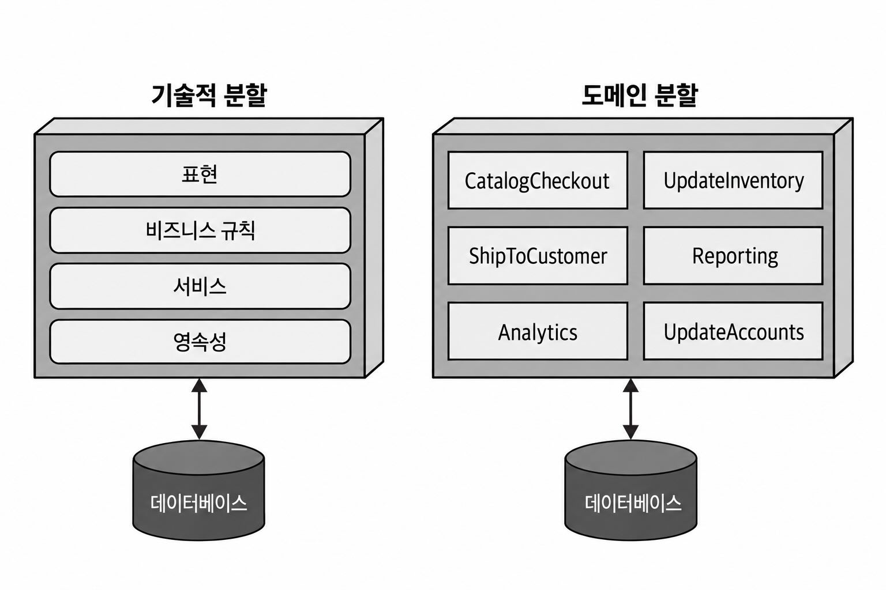
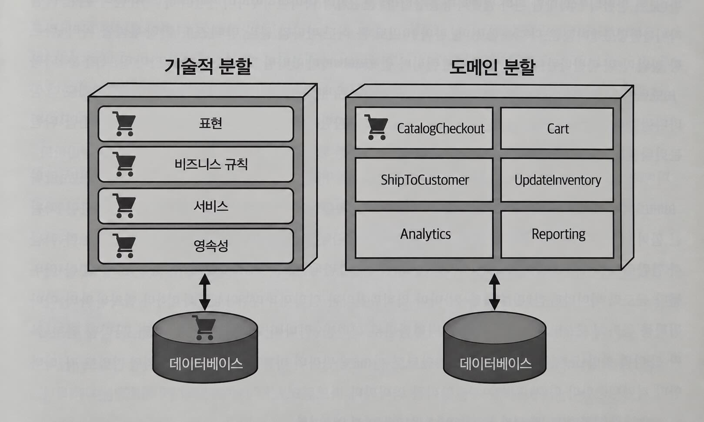

## 아키텍처 스타일의 기초

### 9.1 스타일 대 패턴

- 아키텍처 패턴
    - 특정 상황에서 반복되는 문제에 적용할 수 있는 해법을 나타낸다.
- 아키텍처 스타일
    - 시스템의 전체적인 구조와 그 구조가 가지는 특성의 집합을 설명한다.
    - 스타일 이름을 통해 복잡한 구조와 특성을 간단하게 표현하고 논의할 수 있다.

아키텍처 스타일을 이루는 주요 특징
- 컴포넌트 토폴로지
    - 어떤 컴포넌트가 존재하고 서로 어떤 의존 관계로 구성되는지를 나타낸다.
- 물리적 아키텍처
    - 시스템이 모놀리스형인지 분산형인지 등의 물리적 구조를 나타낸다.
- 배포
    - 시스템의 세분도와 배포 단위, 배포 빈도 등을 나타낸다.
- 통신 스타일
    - 컴포넌트가 직접 호출하는지, REST나 메시지 큐 등 네트워크를 통해 통신하는지를 나타낸다.
- 데이터 토폴로지
    - 데이터를 하나의 저장소에 둘지, 여러 저장소로 분리할지 등의 구조를 나타낸다.

### 9.2 기본적인 아키텍처 패턴

#### 9.2.1 진흙잡탕 안티패턴
- 명확한 구조나 가이드 없이 코드가 성장한 형태
- 변경, 테스트, 확장, 유지보수가 어렵다.
- 구조적 규칙이 없으면 예상치 못한 부작용이 연쇄적으로 발생하기 쉽다.

#### 9.2.2 통일적 아키텍처
- 초기 컴퓨팅에서는 하드웨어와 소프트웨어가 하나의 시스템처럼 결합되어 있었다.
- 시스템이 복잡해지고 정교한 기능이 필요해지면서 기능이 점차 분리되었다.

#### 9.2.3 클라이언트/서버
- 시스템이 복잡해지면서 성능, 확장성 등의 운영 특성을 유지하기 위해 관심사를 분리하기 시작했다.
- 데스크톱 + 데이터베이스 서버
    - 표현 로직은 데스크톱 클라이언트
    - 계산 및 데이터 처리는 데이터베이스 서버
- 브라우저 + 웹 서버
    - 웹의 등장으로 브라우저를 클라이언트로 사용
    - 데스크톱 -> DB 서버 구조와 유사하지만 더 넓게 배포할 수 있음
    - 흔히 2계층 아키텍처로 간주
- 단일 페이지 자바스크립트 애플리케이션
    - 브라우저의 자바스크립트가 발전하면서 브라우저가 리치 클라이언트 역할을 수행
    - 기존 데스크톱 기반 클라이언트/서버 구조와 유사한 형태
- 3계층 아키텍처
    - 프론트엔드 계층 (HTML, 자바스크립트)
    - 애플리케이션 계층 (애플리케이션 서버가 관리)
    - 데이터베이스 계층 (엔터프라이즈급 데이터베이스 서버 사용)
    - 당시 분산 시스템 구축을 위해 CORBA, DCOM 같은 기술을 사용
    - 오늘날에는 당시 직접 다루던 저수준 기능 상당수가 도구나 아키텍처 패턴으로 추상화되어 있다.

### 9.3 아키텍처의 분할
컴포넌트를 어떻게 분할할 것인지에도 트레이드오프가 존재한다.
- 컴포넌트는 일종의 격리/포함 메커니즘이므로 여러 방식으로 나눌 수 있다.
- 어떤 방식으로 나누느냐에 따라 장단점이 달라진다.
- 특히 큰 영향을 주는 결정이 최상위 분할(top-level partitioning) 이다.
    - 시스템을 가장 먼저 어떤 기준으로 큰 덩어리로 나눌 것인지 결정하는 것
    - 이후의 아키텍처 스타일과 코드 구성 방식에도 영향을 준다.

대표적인 최상위 분할 방식
1. 기술적 분할
2. 도메인 분할

기술적 분할
- 시스템을 기술적 역할/역량에 따라 나눈다.
    - 표현, 비즈니스 규칙, 서비스, 영속성
- 계층형 아키텍처가 대표적인 예이다.
- 코드도 기술적 역할에 맞춰 구성된다.
    - 예시) 영속성 관련 코드는 영속성 계층에 모이므로 관련 코드를 찾기 쉽다.
- MVC 같은 익숙한 설계 패턴과도 유사한 구조라 개발자가 이해하기 쉽다.

기술적 분할의 장점
- 기술적 관심사의 분리(separation of technical concerns)가 명확하다.
- 계층 간 결합을 적절히 제한하면 변경의 영향 범위를 줄일 수 있다.
    - 예시) 서비스 계층이 인접한 비즈니스 규칙/영속성 계층에만 의존한다면, 서비스 변경의 영향도 해당 계층 및 의존 컴포넌트 정도로 제한할 수 있다.
- 특정 종류의 코드를 찾기 쉽다.

기술적 분할의 단점
- 실제 비즈니스 작업흐름은 여러 기술 계층을 가로지르는 경우가 많다.
    - 예시) CatalogCheckout이라는 하나의 비즈니스 작업이 표현 -> 비즈니스 규칙 -> 서비스 -> 영속성 계층에 걸쳐 존재할 수 있다.
- 따라서 하나의 도메인 변경이 여러 계층의 코드를 동시에 수정하게 만들 수 있다.

도메인 분할
- 기술적 역할이 아니라 도메인이나 작업흐름을 기준으로최상위 컴포넌트를 나눈다.
    - 예시) CatalogCheckout, UpdateInventory, ShipToCustomer, Reporting 등
- DDD(Domain-Driven Design)의 영향을 받은 방식이다.
    - 서로 독립적인 도메인이나 작업흐름을 식별한다.
- 모듈형 모놀리스나 마이크로서비스 등의 스타일에서 활용할 수 있다.
- 각 도메인 컴포넌트 내부에는 다시 여러 기술적 계층이나 하위 컴포넌트가 존재할 수 있다.
    - 즉, 기술적 분할 자체를 없애는 것이 아니라 최상위 경계를 도메인으로 잡는 것이다.

도메인 분할의 특징
- 하나의 비즈니스 기능에 관련된 코드가 같은 도메인 경계 안에 모인다.
- 프로젝트에서 자주 발생하는 비즈니스 변경을 더 직접적으로 반영할 수 있다.
- 최근의 모듈형/분산 아키텍처에서는 도메인 분할을 사용하는 경우가 많다.

기술적 분할과 도메인 분할
- 기술적 분할
    - 최상위 경계 = 기술적 역할
    - 하나의 도메인/작업흐름이 여러 계층에 걸쳐 나타날 수 있음
- 도메인 분할
    - 최상위 경계 = 도메인/작업흐름
    - 하나의 도메인 내부에 다시 기술적 계층이 존재할 수 있음
- 어느 방식이 항상 더 좋은 것은 아니다.
    - 각각 다른 트레이드오프를 가진다.
- 최상위 분할 방식은 아키텍처 초기에
    - 컴포넌트를 기술 기준으로 식별할지
    - 도메인 기준으로 식별할지 결정하는 중요한 선택이다.

#### 9.3.1 카타: 실리콘 샌드위치-분할
실리콘 샌드위치 예제로 도메인 분할과 기술적 분할을 비교한다.
- 도메인 분할
    - Purchase, Promotion, Inventory, Recipes 등 업무/도메인을 기준으로 먼저 나눈다.
    - 각 도메인 내부에 Common / Local을 둔다.
- 기술적 분할
    - Common / Local 같은 기술적 관심사를 기준으로 먼저 나눈다.
    - 각 영역 안에 Recipes, Inventory, Promotion 등의 도메인 기능을 둔다.

어느 쪽이 항상 더 좋은 것은 아니며 각각 다른 트레이드오프를 가진다.

**도메인 분할**

도메인 분할 아키텍처는 최상위 컴포넌트들을 작업흐름 및/또는 도메인별로 분리한다.

장점
- 구현 세부사항보다는 실제로 비즈니스가 운영되는 방식에 더 가깝게 모델링된다.
- 도메인을 중심으로 CFT(cross-functional team, 교차 기능 팀)를 구축하기 쉽다.
- 모듈형 모놀리스 및 마이크로서비스 아키텍처 스타일과 좀 더 잘 맞는다.
- 메시지 흐름이 문제 도메인과 부합한다.
- 데이터와 컴포넌트를 분산 아키텍처로 마이그레이션하기 쉽다.

단점
- 커스터마이징(customization) 코드가 여러 곳에 나타난다.

**기술적 분할**

기술적 분할 아키텍처는 개별 작업흐름보다는 기술적 역량을 기반으로 최상위 컴포넌트들을 분리한다.
- 흔히 MVC처럼 기술적 역할에 따라 계층을 나눈다.
- 그 밖에도 임의의 기술적 역량을 기준으로 분할할 수 있다.

장점
- 커스터마이징 코드가 명확하게 분리된다.
- 계층형 아키텍처 패턴과 좀 더 잘 맞는다.

단점
- 전역 결합도가 높다.
    - Common이나 Local 같은 컴포넌트를 변경하면 다른 여러 컴포넌트에 영향을 미칠 가능성이 크다.
- 개발자가 도메인 개념을 Common과 Local 양쪽에 중복해서 구현해야 할 수 있다.
- 일반적으로 데이터 수준의 결합도도 높다.
    - 커스터마이징과 여러 도메인의 데이터를 하나의 데이터베이스에 구성할 가능성이 높다.
    - 이후 분산 시스템으로 마이그레이션할 때 복잡하게 얽힌 데이터 관계를 풀어내기 어려울 수 있다.